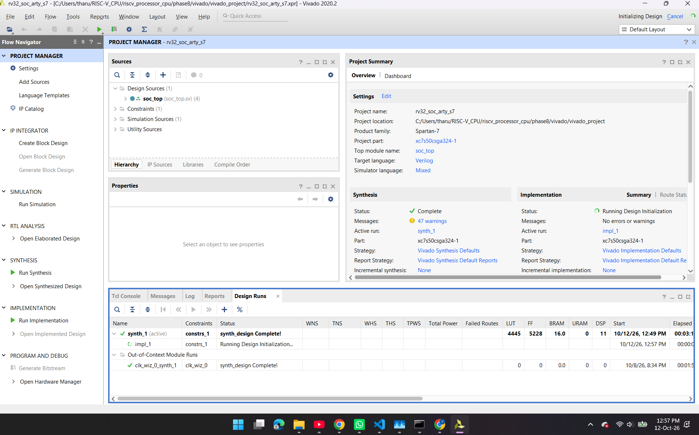
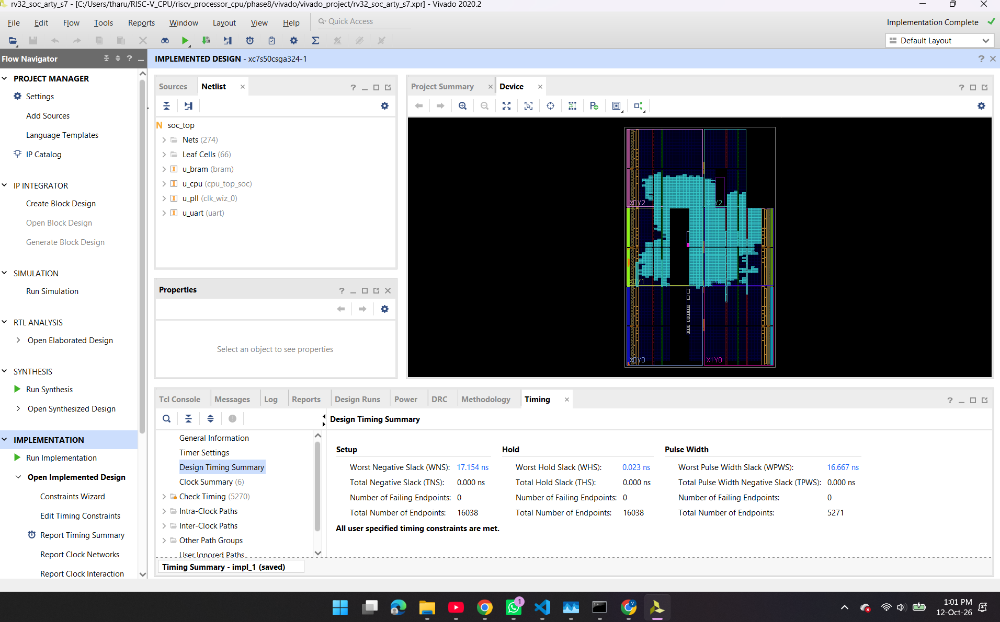
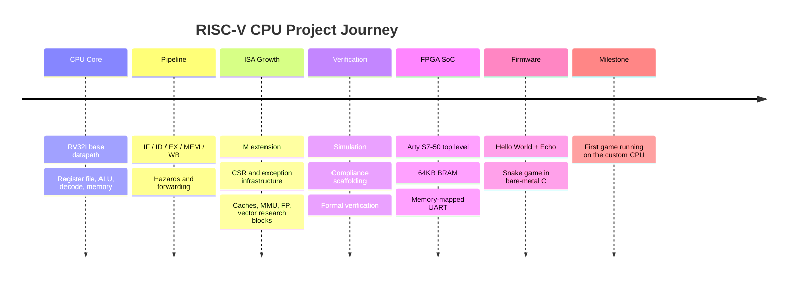

<div align="center">


<br>


<h3>Custom 32-bit RISC-V processor, synthesized onto FPGA, booting real bare-metal firmware.</h3>

<b>Final proof:</b> the CPU runs an interactive UART Snake game in PuTTY on the Arty S7-50.

</div>

---

## ✨ Project Snapshot

This repository contains a complete custom **RISC-V 32-bit CPU and FPGA SoC** project. The processor was designed from scratch in SystemVerilog, expanded through multiple architecture phases, deployed to a Digilent **Arty S7-50**, and verified with real firmware over UART.

The current hardware milestone is no longer just simulation: the CPU boots from on-chip BRAM, talks through a memory-mapped UART peripheral, accepts keyboard input from PuTTY, and runs a playable **Snake game** compiled as bare-metal firmware.

```text
┌──────────────────────────────────────────────────────────────────────┐
│                    RISC-V RV32IM FPGA SoC                            │
├─────────────┬─────────────┬─────────────┬─────────────┬──────────────┤
│ IF          │ ID          │ EX          │ MEM         │ WB           │
│ Fetch       │ Decode      │ ALU/MulDiv  │ BRAM/UART   │ Register WB  │
└──────┬──────┴──────┬──────┴──────┬──────┴──────┬──────┴──────┬───────┘
       │             │             │             │             │
       ▼             ▼             ▼             ▼             ▼
  Branch logic   Hazard unit   Forwarding    Load/store     Retirement

              ┌─────────────────────────────────────┐
              │ 64KB unified Block RAM              │
              │ Port A: instruction fetch           │
              │ Port B: data load/store             │
              └──────────────────┬──────────────────┘
                                 │
                                 ▼
              ┌─────────────────────────────────────┐
              │ UART @ 0x1000_0000                  │
              │ 115200 baud, 8N1, PuTTY terminal    │
              └─────────────────────────────────────┘
```

<div align="center">
  
</div>

---

## 🏆 What Is Working Now

| Layer | Status | Notes |
| :--- | :---: | :--- |
| RV32I base integer ISA | ✅ | Arithmetic, branches, loads/stores, jumps, immediates |
| 5-stage pipeline | ✅ | IF, ID, EX, MEM, WB |
| Hazard handling | ✅ | Load-use stalls plus forwarding paths |
| M extension hardware | ✅ | Multi-cycle `mul` (3 cycles) and iterative `div`/`rem` (34 cycles) unit |
| FPGA timing closure | ✅ | All constraints met at 25 MHz — WNS **+17.154 ns**, 0 failing endpoints |
| CSR / exception infrastructure | ✅ | CSR file and interrupt/trap blocks exist in the architecture tree |
| FPGA SoC integration | ✅ | Arty S7-50 top level with clocking, BRAM, UART, LEDs |
| UART bring-up | ✅ | Hello + keyboard echo verified on real board |
| C firmware support | ✅ | `startup.S`, linker script, UART driver, byte load/store fixes |
| Snake firmware | ✅ | Playable in PuTTY using `W/A/S/D`, `Q`, `R` |
| Formal / phase docs | ✅ | Formal, compliance, architecture, and production notes under `docs/` and `phase5/` |

---

## ✅ Synthesis & Implementation Proof

Screenshots from Vivado 2020.2 for the `rv32_soc_arty_s7` project (`xc7s50csga324-1`), taken after the timing fix and used to build the bitstream that runs Snake on the board.

### Synthesis — `synth_1` complete

<div align="center">
  
</div>

| Resource | Used | Available | Utilization |
| :--- | ---: | ---: | ---: |
| Slice LUTs | 4,445 | 32,600 | 13.6 % |
| Flip-flops | 5,228 | 65,200 | 8.0 % |
| Block RAM tiles | 16 | 75 | 21.3 % |
| DSP slices | 11 | 120 | 9.2 % |

### Implementation — all timing constraints met

<div align="center">
  
</div>

| Check | Worst slack | Total negative slack | Failing endpoints |
| :--- | ---: | ---: | ---: |
| Setup | **+17.154 ns** | 0.000 ns | 0 / 16,038 |
| Hold | +0.023 ns | 0.000 ns | 0 / 16,038 |
| Pulse width | +16.667 ns | 0.000 ns | 0 / 5,271 |

### Before vs after the timing fix

| | Before | After |
| :--- | :---: | :---: |
| Worst negative slack @ 25 MHz | **−61.314 ns** (51 failing endpoints) | **+17.154 ns** (0 failing) |
| Slice LUTs | 9,683 | 4,445 |
| Timing status | Constraints **not** met | All constraints met |

---

## 🎮 The Moment It Became Real

The latest milestone is the one that matters most emotionally and technically:

> A custom RISC-V CPU, running on FPGA, executing your own firmware, drawing a live Snake game over UART.

```text
 RISC-V Snake  |  Score: 60  |  Controls: W=Up  S=Down  A=Left  D=Right  Q=Quit

 +--------------------------------------+
 |                                      |
 |              *                       |
 |                                      |
 |                 +-----------------+  |
 |                 |   GAME  OVER!   |  |
 |                 |   Score: 60     |  |
 |                 | Press R to retry|  |
 |                 +-----------------+  |
 |                                      |
 +--------------------------------------+
```

This is the first game running on the processor.

---

## 🧠 Core Architecture

### CPU Pipeline

| Stage | Purpose |
| :---: | :--- |
| **IF** | Fetch instruction from BRAM using the program counter |
| **ID** | Decode opcode, read registers, generate immediates, detect hazards |
| **EX** | ALU operations, branch resolution, jump target generation, mul/div issue |
| **MEM** | Data memory and memory-mapped peripheral access |
| **WB** | Register file writeback and retirement |

### SoC Memory Map

| Address Range | Device | Description |
| :--- | :--- | :--- |
| `0x0000_0000` - `0x0000_FFFF` | Unified BRAM | Firmware, data, `.bss`, stack |
| `0x1000_0000` - `0x1000_000F` | UART | TX, RX, status registers |

### FPGA Top Level

The active board deployment lives in:

- [`riscv_processor_cpu/phase8/rtl/soc_top.sv`](riscv_processor_cpu/phase8/rtl/soc_top.sv)
- [`riscv_processor_cpu/phase8/rtl/cpu_top_soc.sv`](riscv_processor_cpu/phase8/rtl/cpu_top_soc.sv)
- [`riscv_processor_cpu/phase8/rtl/bram.sv`](riscv_processor_cpu/phase8/rtl/bram.sv)
- [`riscv_processor_cpu/phase8/rtl/uart.sv`](riscv_processor_cpu/phase8/rtl/uart.sv)
- [`riscv_processor_cpu/phase8/constraints/arty_s7_50.xdc`](riscv_processor_cpu/phase8/constraints/arty_s7_50.xdc)

---

## 🛠️ Hardware Bring-Up Fixes

These were the key real-board issues solved during FPGA deployment:

### 1. MMCM Clock Reality Check

The Arty S7 board clock is **12 MHz**. The clocking wizard configuration generates:

```text
12 MHz x 62.5 / 30 = 25 MHz
```

So the SoC UART is configured with:

```systemverilog
.CLK_FREQ(25_000_000),
.BAUD_RATE(115_200)
```

### 2. UART RX Floating Pin

The UART RX line must idle high. The FPGA input pin needed an internal pull-up:

```tcl
set_property -dict { PACKAGE_PIN V12 IOSTANDARD LVCMOS33 PULLUP TRUE } [get_ports { uart_rx }];
```

Without this, the UART receiver could see false start bits and inject garbage.

### 3. Byte-Level C Firmware Support

Assembly hello firmware worked with word operations, but C strings require byte loads and stores. The SoC now handles:

- `SB`, `SH`, `SW`
- `LB`, `LBU`, `LH`, `LHU`, `LW`

This was essential for `snake.c`, `uart_puts()`, strings, cursor movement, and game drawing.

### 4. Timing Closure — Single-Cycle Dividers

The first implementation missed timing by **61 ns** at 25 MHz (40 ns clock period). Two dividers computed a full 32-bit quotient in one clock cycle — `muldiv.sv` for `div`/`rem` and the FPU stub for `fdiv` — producing a ~100 ns path through 335 logic levels.

The fix:

- `muldiv.sv` registers its operands, multiplies in 3 cycles with a single 33×33 signed multiplier, and divides with a radix-2 restoring divider that produces one quotient bit per cycle (34 cycles).
- `fpu_unit.sv` reuses the same iterative divider.

Result: setup slack went from **−61.3 ns to +17.2 ns**, and LUT usage dropped by more than half. See [Synthesis & Implementation Proof](#-synthesis--implementation-proof).

---

## 📁 Repository Map

```text
RISC-V_CPU/
├── README.md                         # Main showcase and quickstart
├── proof/                            # Vivado synthesis + implementation screenshots
└── riscv_processor_cpu/
    ├── rtl/                          # Main advanced CPU architecture modules
    │   ├── cpu_top.sv
    │   ├── alu.sv
    │   ├── control_unit.sv
    │   ├── hazard.sv
    │   ├── muldiv.sv
    │   ├── csr_file.sv
    │   ├── branch_predictor.sv
    │   ├── icache.sv / dcache.sv
    │   ├── mmu.sv
    │   ├── fpu_unit.sv
    │   └── vector_unit.sv
    ├── tb/                           # Simulation testbenches
    ├── docs/                         # Architecture and verification notes
    ├── phase5/                       # Formal/compliance/synthesis milestone
    └── phase8/                       # FPGA SoC deployment
        ├── rtl/                      # Arty S7 SoC RTL
        ├── software/                 # Bare-metal firmware
        ├── constraints/              # Arty S7 pin constraints
        ├── tb/                       # SoC and UART tests
        └── vivado/                   # Vivado project
```

---

## 🚀 Run It On The Arty S7-50

### 1. Open The Firmware Folder

```powershell
cd "C:\Users\tharu\RISC-V_CPU\riscv_processor_cpu\phase8\software"
```

### 2. Choose A Firmware

#### Hello World + Echo

Use this to verify UART, reset, BRAM boot, and keyboard input:

```powershell
make hello_program
```

#### Snake Game

Use this to install the playable game:

```powershell
make program
```

Both commands copy the selected program into:

```text
riscv_processor_cpu/phase8/rtl/firmware.vmem
```

### 3. Reset Vivado Synthesis

Vivado embeds `firmware.vmem` into BRAM during **synthesis**, not at the final bitstream step.

Every time the firmware changes:

1. Open the Vivado project:

   ```text
   riscv_processor_cpu/phase8/vivado/vivado_project/rv32_soc_arty_s7.xpr
   ```

2. In **Design Runs**, right-click `synth_1`.
3. Click **Reset Runs**.
4. Click **Generate Bitstream**.
5. Program the device with `soc_top.bit`.
6. Press **BTN0** on the Arty S7 to boot the CPU.

### 4. PuTTY Setup

| Setting | Value |
| :--- | :--- |
| Connection | Serial |
| Port | `COM4` |
| Speed | `115200` |
| Data | 8 bits |
| Parity | None |
| Stop bits | 1 |
| Flow control | None |
| Local echo | Force off |
| Local line editing | Force off |
| Window size | 80 x 25 or larger |

---

## 🎯 Firmware Programs

| Firmware | Source | Command | Purpose |
| :--- | :--- | :--- | :--- |
| Hello + Echo | [`hello_asm.S`](riscv_processor_cpu/phase8/software/hello_asm.S) | `make hello_program` | Hardware bring-up and UART proof |
| Snake | [`snake.c`](riscv_processor_cpu/phase8/software/snake.c) | `make program` | Interactive game on the custom CPU |

Snake controls:

| Key | Action |
| :---: | :--- |
| `W` | Up |
| `A` | Left |
| `S` | Down |
| `D` | Right |
| `Q` | Quit |
| `R` | Retry after game over |

---

## 🧪 Verification And Testing

The project includes several layers of validation:

- RTL simulation with Icarus Verilog testbenches
- UART loopback testing
- SoC behavioral simulation
- RISC-V compliance scaffolding
- Formal verification experiments under `phase5/formal`
- Physical FPGA validation on Arty S7-50
- Final interactive firmware proof through PuTTY

Useful references:

- [`riscv_processor_cpu/docs/architecture_overview.md`](riscv_processor_cpu/docs/architecture_overview.md)
- [`riscv_processor_cpu/docs/isa_coverage.md`](riscv_processor_cpu/docs/isa_coverage.md)
- [`riscv_processor_cpu/docs/phase5_formal_verification.md`](riscv_processor_cpu/docs/phase5_formal_verification.md)
- [`riscv_processor_cpu/phase8/README.md`](riscv_processor_cpu/phase8/README.md)

---

## 🧰 Toolchain

| Tool | Role |
| :--- | :--- |
| SystemVerilog | CPU, SoC, UART, BRAM RTL |
| Vivado 2020.2 | FPGA synthesis, implementation, bitstream |
| Arty S7-50 | Physical FPGA target |
| `riscv-none-elf-gcc` | Bare-metal firmware build |
| Icarus Verilog / VVP | Simulation |
| PuTTY | UART terminal |
| SymbiYosys | Formal verification experiments |

---

## 🧭 Project Timeline



---

## ⚡ LED Diagnostics

| LED | Meaning |
| :---: | :--- |
| LD0 | CPU released from reset |
| LD1 | PLL/MMCM locked |
| LD2 | UART TX activity |
| LD3 | UART RX activity |

---

## 🌈 Why This Project Matters

Building a CPU is one level of understanding.

Pipelining it is another.

Putting it on an FPGA, discovering real timing, reset, UART, BRAM, and C runtime issues, fixing them, and then running a game on it is the point where the processor becomes real hardware.

This repository captures that full path:

```text
Idea -> RTL -> Pipeline -> ISA -> Verification -> SoC -> FPGA -> Firmware -> Game
```

---

## 🙌 Credits

Special thanks to the AI tools and debugging assistants that helped along the journey, but the milestone belongs to the builder who kept pushing through every hardware bug until the board finally played the game.

<div align="center">

<br>


<br>

**RV32IM CPU • Arty S7-50 • UART Snake • Hardware Verified**

</div>
