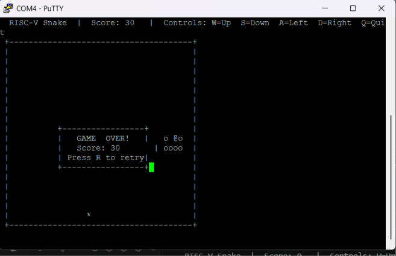
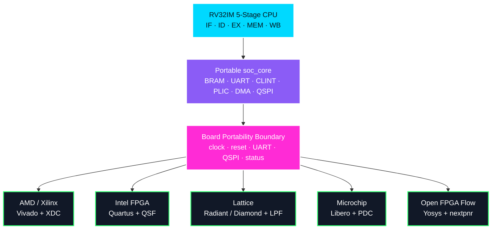
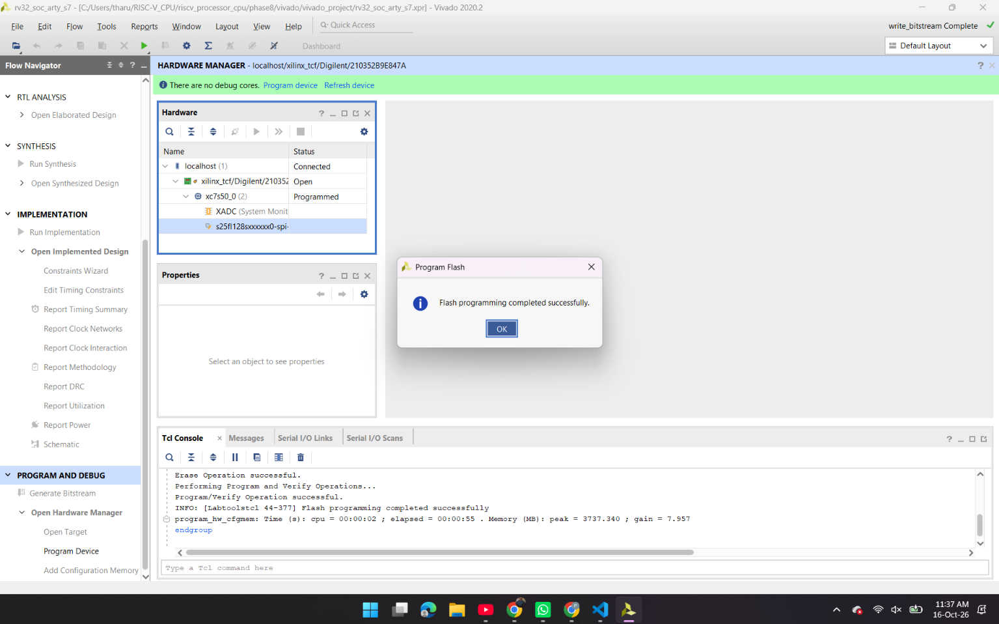
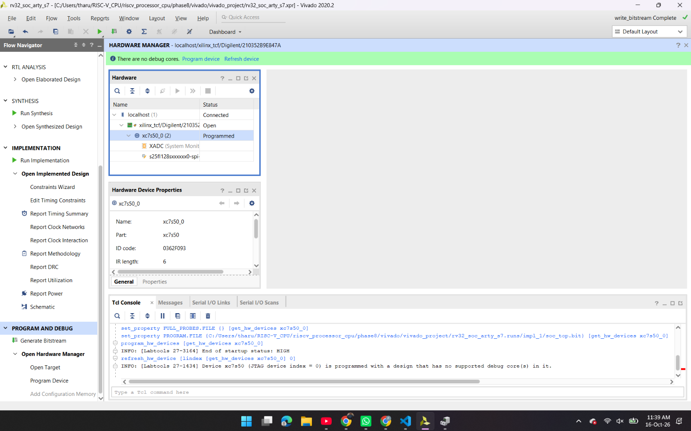
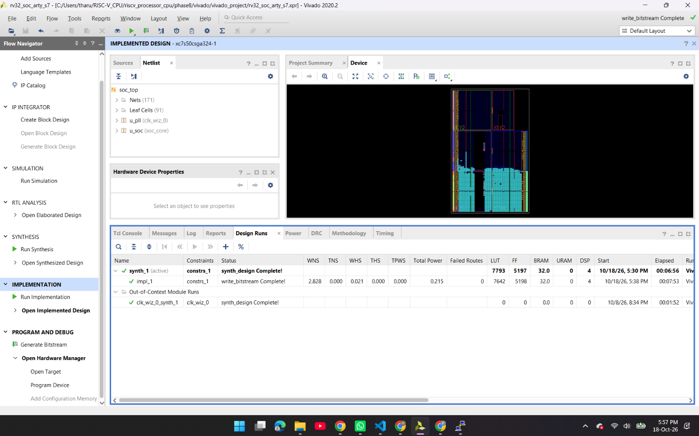
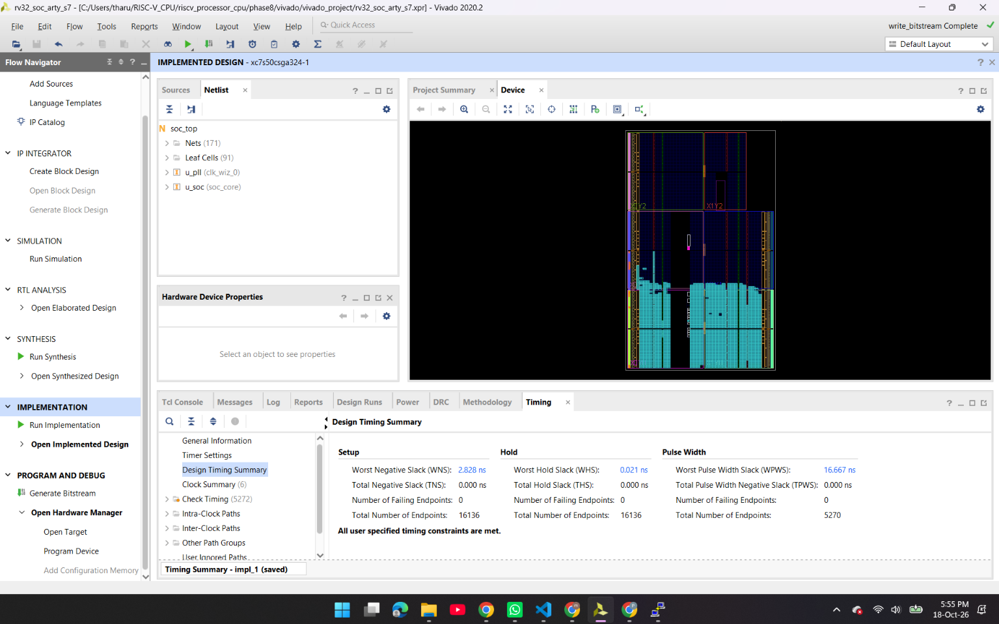
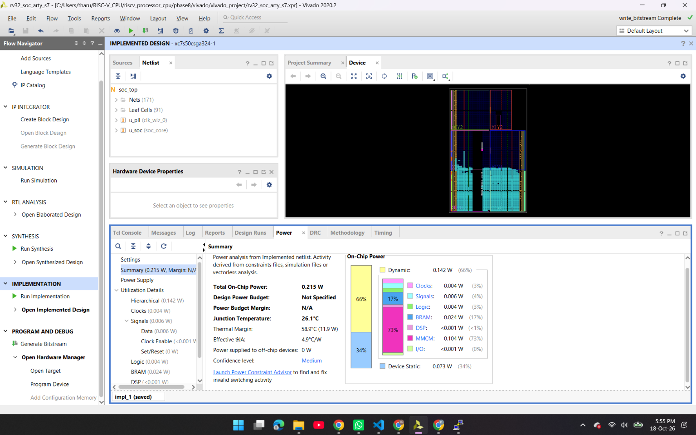
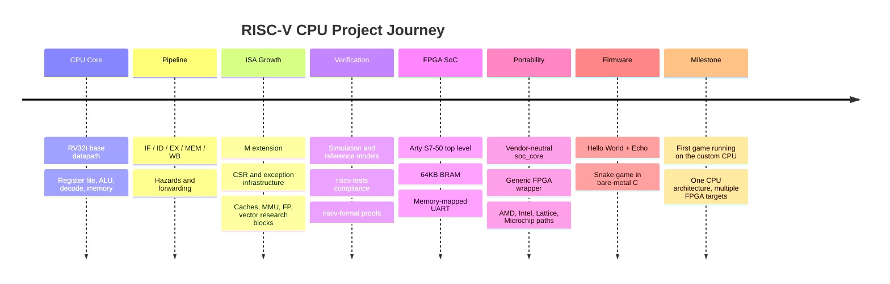

<div align="center">


<br>


<br>


<h3>Custom 32-bit RISC-V processor, portable across FPGA families and running Snake and a DDR-loaded DOOM port on real hardware.</h3>

<b>One RV32IM core. A proven five-stage SoC. An experimental DDR throughput profile. Multiple FPGA ecosystems.</b>

<br><br>
<sub>Base FPGA firmware uses 115200-baud PuTTY. The separate DDR DOOM profile uses a Python graphical viewer over the onboard COM port at 921600 baud, 8N1; PuTTY is only for loader text.</sub>

</div>

---

<div align="center">

[](#-core-architecture)
[](#-multi-fpga-portability)
[](#-persistent-boot-hardware-proof)
[](#-doom-on-the-ddr-soc)
[](#-run-it-on-the-arty-s7-50)
[](riscv_processor_cpu/phase8/PORTING.md)
[](CONTRIBUTING.md)
[](LICENSE)
[](SECURITY.md)

</div>

---

## 🎮 DOOM on the DDR SoC

<div align="center">

[](proof/video.mp4#t=10)

</div>

The DOOM port runs from DDR3 on a **separate experimental throughput bitstream**. The CPU remains at 25 MHz; its limited dual-issue mode is not a general two-wide pipeline. The game image is rendered at 320x200 inside the CPU, sampled to an RGB332 stream, and displayed in a Python window on the laptop. The viewer uses the board's onboard USB-UART connection; it is **not ANSI graphics in PuTTY** and does not require the CP2102 adapter.

| Display / link | Current profile |
| :--- | :--- |
| Python graphical viewer | [`doom_viewer.py`](riscv_processor_cpu/phase8/software/doom_viewer.py), keyboard input returns over the same serial link |
| Stream format | RGB332 RVF1/RVF2; RVF2 uses RLE when smaller and XOR deltas with periodic keyframes |
| UART | `921600` baud, 8 data bits, no parity, 1 stop bit (8N1) |
| Resolution | 80x50 baseline; configurable detail profile up to 200x150 sampled from the 320x200 engine framebuffer |
| Board measurements | About 4.6 FPS at 80x50, 4.2 FPS at 120x75 and 2.2 FPS at 160x100 in reported runs; 200x150 is buildable but not yet board-validated |

Focus the viewer window for controls: arrow keys or `W/A/S/D` move, `Ctrl`/`F` fires, `Space`/`E` uses, `Esc`/`Q` opens the menu, and `Enter` confirms.

The output detail/FPS tradeoff is real: higher resolutions move and render more pixels, and 200x150 is **not** a 5-FPS or 45-FPS claim. See the full measurements and design notes in [`doom_feasibility.md`](riscv_processor_cpu/docs/doom_feasibility.md). The tracked build entry points are [`software/Makefile`](riscv_processor_cpu/phase8/software/Makefile), [`create_ddr_project.tcl`](riscv_processor_cpu/phase8/vivado/create_ddr_project.tcl), and [`build_ddr_throughput.tcl`](riscv_processor_cpu/phase8/vivado/build_ddr_throughput.tcl). Vivado projects, `.bit` files, generated `.bin` images, and the DOOM IWAD are local build/runtime inputs, not files committed to this repository.

### Run DOOM on the Arty S7

For a first build, from `riscv_processor_cpu/phase8/software` create the separate Vivado project and run its checked implementation/bitstream flow:

```powershell
make ddr_throughput_project
make ddr_throughput_build
```

The build checks routed timing and blocking DRCs before writing a bitstream; it does not program the board. The generated project is under `riscv_processor_cpu/phase8/vivado/ddr_project/arty_s7_ddr_throughput/`; program `riscv_processor_cpu/phase8/vivado/ddr_project/arty_s7_ddr_throughput/rv32_soc_arty_s7.runs/impl_1/arty_s7_ddr_top.bit` in Hardware Manager. Keep PuTTY closed while uploading and viewing so only one program owns `COM4`.

From `riscv_processor_cpu/phase8/software`, with the loader at its idle prompt and the local shareware IWAD at the Makefile's configured path:

```powershell
make ddr_throughput_upload PORT=COM4 UPLOAD_DELAY=0
make ddr_doom_view PORT=COM4 DDR_BAUD=921600
```

The upload includes the application and WAD; wait for its success message, then start the viewer. Do not press BTN0 or reprogram between upload and opening the viewer. After the game exits, close the viewer and press BTN0 once before another upload. PuTTY can inspect the loader at **921600 baud** when the Python viewer is closed, but it cannot display the binary frame stream.

To build and upload the higher-detail 200x150 profile instead:

```powershell
make ddr_throughput_detail_upload DOOM_DETAIL_WIDTH=200 DOOM_DETAIL_HEIGHT=150 PORT=COM4 UPLOAD_DELAY=0
make ddr_doom_view PORT=COM4 DDR_BAUD=921600
```

The 200x150 path is an experimental resolution setting; expect lower or scene-dependent FPS. Close the viewer and return the board to the loader with BTN0 before uploading a different image.

<a id="snake-hardware-proof"></a>
### Snake Running on Its Own CPU

<div align="center">
  
  <br>
  <sub>Separate hardware proof: Snake boots from QSPI, is CRC-checked and executes from BRAM.</sub>
</div>

---

## ✨ Project Snapshot

For a source-derived visual explanation of the CPU pipeline, FPGA SoC, firmware build,
verification flow, and UART runtime path, open
[`riscv_processor_cpu/docs/architecture_workflow.html`](riscv_processor_cpu/docs/architecture_workflow.html)
in a browser.

This repository contains a complete custom **RISC-V 32-bit CPU and FPGA SoC** project. The processor was designed from scratch in SystemVerilog, expanded through multiple architecture phases, deployed to a Digilent **Arty S7-50**, and verified with persistent firmware and a live UART application. The SoC logic is now separated from its board wrapper, so the same CPU can target other AMD/Xilinx, Intel/Altera, or Lattice FPGAs without carrying Arty-specific clock and startup primitives into the portable core.

The current hardware milestone is fully physical: the FPGA configures from the board's QSPI flash, the resident Boot ROM validates an `RVF1` image with CRC-32, copies Snake into BRAM, executes `FENCE.I`, and starts the playable game over PuTTY. If flash is absent or damaged, the same loader enters UART recovery instead of executing an unsafe image.

A second, separately built Arty S7 profile runs the DOOM shareware engine from
DDR3. It combines the restricted dual-issue CPU configuration, instruction
and data caches, an ordered write buffer, a fast UART video stream and the
Python graphical viewer described at the top of this README. The Snake/QSPI
proof and the DDR/DOOM proof are distinct builds and workflows.

The current core combines two memory-performance domains: one-cycle
instruction and data TCM paths keep the five-stage pipeline fast for local
BRAM, while a `valid`/`ready` transaction fabric safely handles variable
latency MMIO, DMA, MMU page-table walks and future AXI or external-memory
bridges. This split is synthesized, timing-closed and verified on hardware.

| POWER-ON BOOT | INTEGRITY | RECOVERY | APPLICATION |
| :---: | :---: | :---: | :---: |
| QSPI configuration flash | Header + size + entry + CRC-32 | Flow-controlled UART upload | Interactive Snake in PuTTY |

```text
┌──────────────────────────────────────────────────────────────────────┐
│                    RISC-V RV32IM FPGA SoC                            │
├─────────────┬─────────────┬─────────────┬─────────────┬──────────────┤
│ IF          │ ID          │ EX          │ MEM         │ WB           │
│ Fetch       │ Decode      │ ALU/MulDiv  │ BRAM/UART   │ Register WB  │
└──────┬──────┴──────┬──────┴──────┬──────┴──────┬──────┴──────┬───────┘
       │             │             │             │             │
       ▼             ▼             ▼             ▼             ▼
  Branch logic   Hazard unit   Forwarding    Load/store     Retirement

              ┌─────────────────────────────────────┐
              │ 64KB unified Block RAM              │
              │ Port A: instruction fetch           │
              │ Port B: data load/store             │
              └──────────────────┬──────────────────┘
                                 │
                                 ▼
              ┌─────────────────────────────────────┐
              │ UART @ 0x1000_0000                  │
              │ 115200 baud, 8N1, PuTTY terminal    │
              └─────────────────────────────────────┘
```

<div align="center">
  
</div>

## 🌐 Multi-FPGA Portability

<div align="center">


<br>

<a href="https://www.amd.com/en/products/adaptive-socs-and-fpgas.html"></a>
<a href="https://www.intel.com/content/www/us/en/products/details/fpga.html"></a>
<a href="https://www.latticesemi.com/"></a>
<a href="https://www.microchip.com/en-us/products/fpgas-and-plds"></a>
<a href="https://yosyshq.net/yosys/"></a>

<br><br>


<br>

<b>The Arty S7-50 is the first proven home, not the permanent boundary.</b>

</div>

The five-stage RV32IM pipeline is now treated as reusable silicon IP. CPU
behavior, firmware-visible addresses, interrupts, DMA, UART, boot flow and bus
logic live below a clean portability boundary. Moving to another FPGA should
change the clock/reset adapter, physical pins and vendor constraints, not the
processor architecture.

> [!IMPORTANT]
> **Hardware-proven target:** Digilent Arty S7-50 / AMD Spartan-7.
> **Portable RTL targets:** other AMD/Xilinx, Intel, Lattice and Microchip
> families through a board-specific wrapper. These targets still require
> synthesis, timing closure and physical validation on the selected board.

### One Architecture, Three Layers



| Layer | Source | Responsibility | Changes between boards? |
| :--- | :--- | :--- | :---: |
| **CPU architecture** | [`cpu_top_soc.sv`](riscv_processor_cpu/phase8/rtl/cpu_top_soc.sv) | RV32IM pipeline, hazards, forwarding, CSR/traps and memory buses | **No** |
| **Portable SoC** | [`soc_core`](riscv_processor_cpu/phase8/rtl/soc_core_txn.sv) | Fast I/D TCM, transaction arbiter, BRAM, UART, CLINT, PLIC, DMA and QSPI | **No** |
| **Generic FPGA shell** | [`generic_fpga_top.sv`](riscv_processor_cpu/phase8/rtl/generic_fpga_top.sv) | Stable clock input, synchronized reset, ordinary QSPI pins and status outputs | Usually no |
| **Board adapter** | Board-specific top + constraints | PLL/MMCM, startup primitive, pinout, I/O voltage and configuration flash access | **Yes** |
| **Reference adapter** | [`soc_top`](riscv_processor_cpu/phase8/rtl/soc_top.sv) | Arty S7 Clocking Wizard, `STARTUPE2`, reset polarity and LEDs | Arty only |

### FPGA Ecosystem Matrix

| FPGA ecosystem | Example families | Build flow | Required board layer | Project status |
| :--- | :--- | :--- | :--- | :---: |
| **AMD / Xilinx** | Spartan-7, Artix-7, Kintex-7, Zynq PL, UltraScale | Vivado + XDC | Clocking Wizard/MMCM, optional `STARTUPE2`, pin constraints | **Arty S7 verified** |
| **Intel FPGA** | Cyclone, MAX 10, Arria | Quartus Prime + QSF | Intel PLL, reset synchronizer, pin assignments | RTL ready |
| **Lattice Semiconductor** | iCE40, ECP5, Certus-NX, CrossLink-NX | Radiant/Diamond or Yosys + nextpnr | Family PLL and LPF/PCF constraints | RTL ready |
| **Microchip FPGA** | PolarFire, IGLOO2, SmartFusion2 | Libero SoC + PDC | CCC clock block, reset and pin constraints | Integration path |
| **Other FPGA families** | Any device with sufficient LUTs, registers and RAM | Vendor or open-source tools | Thin wrapper matching that device's primitives | Architecture ready |

“RTL ready” means the vendor-neutral design boundary is available. It does not
claim timing closure or board execution until that family has been synthesized
and tested.

### Portable Build Contract

| Parameter | Default | What it controls |
| :--- | ---: | :--- |
| `CLK_FREQ_HZ` | `25_000_000` | Real SoC clock and UART timing calculation |
| `UART_BAUD` | `115_200` | Serial-console baud rate |
| `BRAM_SIZE_BYTES` | `65_536` | Inferred unified instruction/data memory size |
| `FIRMWARE_FILE` | `firmware.vmem` | Power-on BRAM initialization image |
| `FAST_LOCAL_IMEM` | `1` | One-cycle BRAM instruction TCM instead of transactional fetch |
| `FAST_LOCAL_DMEM` | `1` | One-cycle BRAM data TCM; MMIO/external accesses remain transactional |
| `PORTABLE_BUILD` | Defined by the new project | Removes Xilinx-only `clk_wiz_0` and `STARTUPE2` dependencies |

The shared source list is maintained in
[`portable_soc.f`](riscv_processor_cpu/phase8/rtl/portable_soc.f). Inferred RAM
carries AMD/Xilinx, Intel and Synplify/Lattice-compatible block-memory hints.

### Port The CPU In Seven Steps

1. Add every source from [`portable_soc.f`](riscv_processor_cpu/phase8/rtl/portable_soc.f).
2. Define `PORTABLE_BUILD` so vendor-specific Arty logic is excluded.
3. Select `generic_fpga_top` or wrap `soc_core` directly.
4. Supply a stable clock and set `CLK_FREQ_HZ` to its actual frequency.
5. Add the target board's PLL, reset logic and QSPI startup primitive when required.
6. Add pin, I/O-standard and timing constraints for that exact board.
7. Simulate, inspect inferred RAM, synthesize, close timing and validate UART on hardware.

```powershell
cd riscv_processor_cpu\phase8\tb
make portable
```

```text
PASS portable wrapper holds reset
PASS portable reset deasserts synchronously
PASS 20 MHz UART divisor is propagated
PASS CPU executes from inferred BRAM
PASS UART idle level is high
PASS: vendor-neutral SoC wrapper at 20 MHz
```

The full board checklist, QSPI caveats and vendor notes are in the
**[FPGA Porting Guide](riscv_processor_cpu/phase8/PORTING.md)**.

The portable-core claims above cover the vendor-neutral CPU and baseline SoC.
The DDR3/MIG DOOM throughput profile is currently an Arty S7-specific board
integration, not a claim that its external-memory PHY is portable.

---

## 🏆 What Is Working Now

| Layer | Status | Notes |
| :--- | :---: | :--- |
| RV32I base integer ISA | ✅ | Arithmetic, branches, loads/stores, jumps, immediates |
| 5-stage pipeline | ✅ | IF, ID, EX, MEM, WB |
| Hazard handling | ✅ | Load-use stalls plus forwarding paths |
| M extension hardware | ✅ | Multi-cycle `mul` (3 cycles) and iterative `div`/`rem` (34 cycles) unit |
| FPGA timing closure | ✅ | Transaction-bus + TCM build meets 25 MHz timing: WNS **+2.828 ns**, WHS **+0.021 ns**, 0 failing endpoints |
| CSR / exception infrastructure | ✅ | M/S/U privilege, delegated traps, `MRET`/`SRET`, vectored trap delivery, 64-bit counters |
| Physical Memory Protection | ✅ | Four PMP entries with OFF/TOR/NA4/NAPOT matching and lock enforcement |
| FPGA SoC integration | ✅ | Arty S7-50 top level with clocking, parity-banked I/D TCM, transaction fabric, UART, CLINT, PLIC, DMA, QSPI and LEDs |
| FPGA portability | ✅ RTL | Vendor-neutral `soc_core`, generic wrapper, parameterized clock/UART/memory, multi-vendor BRAM hints, source manifest and 20 MHz portability regression |
| Hardware interrupts | ✅ | 64-bit `mtime`/`mtimecmp`, machine software IRQ, and 5-source priority/claim controller |
| DMA controller | ✅ FPGA | Bus-mastered 8/16/32-bit memory copies, UART flow control, progress/error status, PLIC completion IRQ and CPU-TCM arbitration |
| Transaction bus | ✅ FPGA | Four-master `valid`/`ready` fabric for CPU, DMA and MMU PTW with backpressure, errors and AXI-Lite bridge |
| Fast local memory | ✅ FPGA | Dedicated one-cycle instruction Port A and CPU-priority data Port B restore original five-stage throughput |
| UART bring-up | ✅ | Hello + keyboard echo verified; simultaneous RX/read collision regression passes |
| UART bootloader | ✅ | CRC-32 checked application uploads to `0x0000_4000` without FPGA re-synthesis |
| QSPI flash boot | ✅ | Persistent `RVF1` image, CRC-checked RAM copy, automatic start, and UART recovery verified on FPGA |
| C firmware support | ✅ | `startup.S`, linker script, UART driver, aligned and cross-word byte/halfword/word accesses |
| Cache hierarchy | ✅ | Research core has L1 I/D plus L2; separate DDR FPGA profile has 8 KiB I/D caches with refill and coherent ordered writes |
| DDR throughput profile | ✅ board-tested | Separate Arty S7 DDR3/MIG bitstream: 8 KiB I-cache, 8 KiB D-cache, restricted dual issue and an ordered four-entry write buffer |
| DOOM graphical output | ✅ board-tested | Python RGB332/RVF2 viewer over onboard UART at 921600 baud; measured profiles and resolution limits are described above |
| Snake firmware | ✅ | Playable in PuTTY using `W/A/S/D`, `Q`, `R` |
| ISA compliance (riscv-tests) | ✅ | All applicable official tests pass: 66/66 FPGA, 77/77 research, 11/11 FPGA + FPU; zero N/A |
| Formal verification (riscv-formal) | ✅ | 52/52 checks pass on the FPGA core: every RV32IM instruction proven against the ISA model |
| F extension / RVV subset | ✅ | IEEE-754 RV32F unit and RVV 1.0 integer subset in the research core (not in the FPGA build) |

---

## ⚡ Persistent Boot: Hardware Proof

The complete chain is verified on the Arty S7-50: the combined MCS image was
programmed and verified in the 128-Mbit configuration flash, the Spartan-7
configured successfully, and Snake ran from the application copied into BRAM
by the custom Boot ROM.

<table>
  <tr>
    <td width="50%" align="center"><b>1. Flash programmed and verified</b></td>
    <td width="50%" align="center"><b>2. FPGA configured from QSPI</b></td>
  </tr>
  <tr>
    <td></td>
    <td></td>
  </tr>
</table>

<div align="center">
  <b>3. Persistent firmware executed on the custom CPU</b><br><br>
  
</div>

```text
QSPI @ 0x0040_0000 -> RVF1 header -> CRC-32 -> BRAM @ 0x0000_4000
                    -> FENCE.I -> application entry -> RISC-V Snake
```

---

## ✅ Synthesis & Implementation Proof

Vivado 2020.2 results for the hardened `rv32_soc_arty_s7` project
(`xc7s50csga324-1`). The current QSPI-enabled build completes synthesis,
implementation, bitstream generation, flash programming, and physical-board
execution successfully. These measurements document the QSPI/TCM build, not
the separate DDR-throughput project's resource or timing reports.

### Synthesis and implementation — final transaction-bus build

<div align="center">
  
</div>

| Resource | Synthesized | Implemented | Available | Final utilization |
| :--- | ---: | ---: | ---: | ---: |
| Slice LUTs | 7,793 | 7,642 | 32,600 | 23.44 % |
| Flip-flops | 5,197 | 5,198 | 65,200 | 7.97 % |
| Block RAM tiles | 32 | 32 | 75 | 42.7 % |
| DSP slices | 4 | 4 | 120 | 3.3 % |

### Implementation — all timing constraints met

<div align="center">
  
</div>

| Check | Worst slack | Total negative slack | Failing endpoints |
| :--- | ---: | ---: | ---: |
| Setup | **+2.828 ns** | 0.000 ns | 0 / 16,136 |
| Hold | **+0.021 ns** | 0.000 ns | 0 / 16,136 |
| Pulse width | +16.667 ns | 0.000 ns | 0 / 5,270 |

### Implementation power

<div align="center">
  
</div>

| Measurement | Result |
| :--- | ---: |
| Total on-chip power | **0.215 W** |
| Dynamic power | 0.142 W |
| Device static power | 0.073 W |
| Junction temperature | 26.1 C |
| Thermal margin | 58.9 C |

### Before vs after the timing fix

| | Before | After |
| :--- | :---: | :---: |
| Worst negative slack @ 25 MHz | **−61.314 ns** (51 failing endpoints) | **+2.828 ns** (0 failing) |
| Slice LUTs | 9,683 | 7,642 after implementation |
| Timing status | Constraints **not** met | All constraints met |

---

## 🎮 The Moment It Became Real

The latest milestone is the one that matters most emotionally and technically:

> A custom RISC-V CPU, running on FPGA, executing your own firmware, drawing a live Snake game over UART.

```text
 RISC-V Snake  |  Score: 60  |  Controls: W=Up  S=Down  A=Left  D=Right  Q=Quit

 +--------------------------------------+
 |                                      |
 |              *                       |
 |                                      |
 |                 +-----------------+  |
 |                 |   GAME  OVER!   |  |
 |                 |   Score: 60     |  |
 |                 | Press R to retry|  |
 |                 +-----------------+  |
 |                                      |
 +--------------------------------------+
```

This is the first game running on the processor.

---

## 🧠 Core Architecture

### CPU Pipeline

| Stage | Purpose |
| :---: | :--- |
| **IF** | Fetch instruction from BRAM using the program counter |
| **ID** | Decode opcode, read registers, generate immediates, detect hazards |
| **EX** | ALU operations, branch resolution, jump target generation, mul/div issue |
| **MEM** | Data memory and memory-mapped peripheral access |
| **WB** | Register file writeback and retirement |

The verified base SoC uses a conventional in-order five-stage pipeline. A
separate Arty S7 DDR-throughput profile adds an **8 KiB instruction cache** and
an **8 KiB data cache**. Its limited dual-issue mode pairs only adjacent,
aligned, independent simple RV32I integer ALU, `LUI`, or `AUIPC` instructions;
it is not a general two-instruction-wide pipeline. Cache-miss fills and
variable-latency DDR accesses still stall the core.

The DDR profile also has a four-entry ordered posted-write buffer. It preserves
store order and drains/invalidates around DMA and page-table-walker accesses so
CPU and non-CPU DDR users do not observe stale data. These features are scoped
to the separate throughput build; the base QSPI/Snake bitstream remains the
five-stage TCM design.

### SoC Memory Map

| Address Range | Device | Description |
| :--- | :--- | :--- |
| `0x0000_0000` - `0x0000_FFFF` | Unified BRAM | Firmware, data, `.bss`, stack |
| `0x0200_0000` - `0x0200_FFFF` | CLINT | `msip`, 64-bit `mtimecmp`, 64-bit `mtime` |
| `0x0C00_0000` - `0x0C3F_FFFF` | PLIC | Priority, pending, enable, threshold, claim/complete |
| `0x1000_0000` - `0x1000_000F` | UART | TX, RX, status registers |
| `0x1000_1000` - `0x1000_100F` | QSPI reader | Flash address, byte data, control/status, peripheral ID |
| `0x1000_2000` - `0x1000_201F` | DMA | Source, destination, length, control, status, progress, ID, remaining bytes |
| `0x8000_0000` onward | DDR3 | Application image and runtime memory in the Arty S7 DDR throughput profile |
| `0x8200_0000` onward | DDR3 WAD region | Uploaded DOOM IWAD handoff/data region in the DDR profile |

### DMA Data Movement

The Phase 8 SoC includes a synthesizable single-channel bus-master DMA engine.
Firmware programs a source address, destination address, byte length, transfer
width, and independent source/destination increment controls. The DMA then
uses data-bus cycles that the CPU is not using, so instruction execution can
continue without adding a stall/ready signal to the existing pipeline.

Current RTL integration verifies BRAM-to-BRAM copies and flow-controlled
BRAM-to-UART transmission. Fixed-address endpoints make the same engine usable
for RX/TX FIFOs in future SPI, display, VGA, or external-memory peripherals;
their ready signals are added to the SoC arbiter just like UART readiness.
Completion and errors are sticky, invalid addresses terminate instead of
hanging, and interrupt-enabled transfers arrive through PLIC source ID 5.
Bare-metal helpers are provided in
[`dma.h`](riscv_processor_cpu/phase8/software/dma.h).

### FPGA Top Level

The active board deployment lives in:

- [`riscv_processor_cpu/phase8/rtl/soc_top.sv`](riscv_processor_cpu/phase8/rtl/soc_top.sv)
- [`riscv_processor_cpu/phase8/rtl/soc_core_txn.sv`](riscv_processor_cpu/phase8/rtl/soc_core_txn.sv)
- [`riscv_processor_cpu/phase8/rtl/rv_bus_arbiter.sv`](riscv_processor_cpu/phase8/rtl/rv_bus_arbiter.sv)
- [`riscv_processor_cpu/phase8/rtl/rv_bus_to_axi_lite.sv`](riscv_processor_cpu/phase8/rtl/rv_bus_to_axi_lite.sv)
- [`riscv_processor_cpu/phase8/rtl/cpu_top_soc.sv`](riscv_processor_cpu/phase8/rtl/cpu_top_soc.sv)
- [`riscv_processor_cpu/phase8/rtl/bram.sv`](riscv_processor_cpu/phase8/rtl/bram.sv)
- [`riscv_processor_cpu/phase8/rtl/uart.sv`](riscv_processor_cpu/phase8/rtl/uart.sv)
- [`riscv_processor_cpu/phase8/rtl/clint.sv`](riscv_processor_cpu/phase8/rtl/clint.sv)
- [`riscv_processor_cpu/phase8/rtl/plic.sv`](riscv_processor_cpu/phase8/rtl/plic.sv)
- [`riscv_processor_cpu/phase8/constraints/arty_s7_50.xdc`](riscv_processor_cpu/phase8/constraints/arty_s7_50.xdc)

The DDR-specific board wrapper, MIG interface, cache/fetch changes and stream
transport are maintained as a separate generated Vivado project. Its tracked
project-generation and build scripts are
[`create_ddr_project.tcl`](riscv_processor_cpu/phase8/vivado/create_ddr_project.tcl)
and [`build_ddr_throughput.tcl`](riscv_processor_cpu/phase8/vivado/build_ddr_throughput.tcl);
the generated `.xpr` and `.bit` artifacts are intentionally not tracked.

---

## 🛠️ Hardware Bring-Up Fixes

These were the key real-board issues solved during FPGA deployment:

### 1. MMCM Clock Reality Check

The Arty S7 board clock is **12 MHz**. The clocking wizard configuration generates:

```text
12 MHz x 62.5 / 30 = 25 MHz
```

So the SoC UART is configured with:

```systemverilog
.CLK_FREQ(25_000_000),
.BAUD_RATE(115_200)
```

### 2. UART RX Floating Pin

The UART RX line must idle high. The FPGA input pin needed an internal pull-up:

```tcl
set_property -dict { PACKAGE_PIN V12 IOSTANDARD LVCMOS33 PULLUP TRUE } [get_ports { uart_rx }];
```

Without this, the UART receiver could see false start bits and inject garbage.

### 3. Byte-Level C Firmware Support

Assembly hello firmware worked with word operations, but C strings require byte loads and stores. The SoC now handles:

- `SB`, `SH`, `SW`
- `LB`, `LBU`, `LH`, `LHU`, `LW`

This was essential for `snake.c`, `uart_puts()`, strings, cursor movement, and game drawing.

### 4. Timing Closure — Single-Cycle Dividers

The first implementation missed timing by **61 ns** at 25 MHz (40 ns clock period). Two dividers computed a full 32-bit quotient in one clock cycle — `muldiv.sv` for `div`/`rem` and the FPU stub for `fdiv` — producing a ~100 ns path through 335 logic levels.

The fix:

- `muldiv.sv` registers its operands, multiplies in 3 cycles with a single 33×33 signed multiplier, and divides with a radix-2 restoring divider that produces one quotient bit per cycle (34 cycles).
- The FPU stub's divider was removed from the board build (the FPU now uses its own iterative FDIV/FSQRT and is not part of the FPGA SoC by default).

Result: the final transaction-bus + TCM design closes timing with **+2.828 ns setup slack** and **+0.021 ns hold slack**. See [Synthesis & Implementation Proof](#-synthesis--implementation-proof).

### 5. UART RX Read/Arrival Collision

RX arrival now has priority when a CPU read and a newly completed UART byte occur in the same cycle. The replacement byte remains valid instead of being silently cleared.

### 6. Physical Memory Protection

The core now implements four PMP entries with OFF, TOR, NA4 and NAPOT regions, lowest-entry priority, machine-mode bypass rules, lock bits, and instruction/load/store access-fault generation.

### 7. Hardware Misaligned Accesses

Scalar byte, halfword and word operations can cross a 32-bit word boundary. The FPGA memory uses even/odd true dual-port BRAM banks so both adjacent words are available in one cycle while still mapping to block RAM.

### 8. Supervisor Privilege

The privileged architecture now supports M/S/U modes, trap and interrupt delegation, supervisor CSRs and aliases, `SRET`, Sv32 permission checks, `SUM`, `MXR`, `TVM`, and `TSR` behavior.

### 9. Transaction Bus Without Sacrificing Local Speed

The CPU, DMA engine and MMU page-table walker now use a backpressured
request/response fabric for variable-latency accesses. Initial integration
routed every instruction and stack access through that fabric and reduced
throughput. The final hardware keeps local BRAM on dedicated one-cycle I-TCM
and D-TCM paths while MMIO, DMA, PTW and future external memory remain fully
transactional. This restored the original Snake speed on the physical FPGA.

### 10. Functional Cache Hierarchy

The research core has direct-mapped L1 instruction/data caches and a unified
L2 with refill, write-through stores, invalidation and hit/miss counters. The
Arty S7 DDR throughput profile is a distinct implementation: it adds an 8 KiB
instruction cache, an 8 KiB data cache, a four-entry ordered posted-write
buffer, and the board-specific DDR3/MIG path. Do not confuse the research
core's DRAM model with the physical DDR3-backed board profile.

---

## 📁 Repository Map

```text
RISC-V_CPU/
├── README.md                         # Main showcase and quickstart
├── proof/                            # Timing, flash programming, FPGA, and runtime proof
├── riscv-tests/                      # Submodule: official ISA tests (git submodule update --init --recursive)
└── riscv_processor_cpu/
    ├── rtl/                          # Main advanced CPU architecture modules
    │   ├── cpu_top.sv
    │   ├── alu.sv
    │   ├── control_unit.sv
    │   ├── hazard.sv
    │   ├── muldiv.sv
    │   ├── csr_file.sv
    │   ├── branch_predictor.sv
    │   ├── icache.sv / dcache.sv
    │   ├── mmu.sv
    │   ├── fpu_unit.sv
    │   └── vector_unit.sv
    ├── tb/                           # Testbenches + Python reference models + run_regression.py
    ├── docs/                         # Architecture and verification notes
    ├── formal/riscv-formal/          # riscv-formal setup for the FPGA core
    ├── phase5/compliance/            # riscv-tests runner and results
    ├── phase5/                       # Synthesis templates and Phase 5 report
    └── phase8/                       # FPGA SoC deployment
        ├── PORTING.md                # Multi-vendor board-porting guide
        ├── rtl/                      # Portable SoC + FPGA board wrappers
        │   ├── soc_top.sv            # Arty wrapper and legacy reference core
        │   ├── soc_core_txn.sv       # Portable SoC, fast TCM and transaction targets
        │   ├── rv_bus_arbiter.sv     # CPU/DMA/PTW request-response arbitration
        │   ├── rv_bus_to_axi_lite.sv # Bridge for AXI-Lite integration
        │   ├── generic_fpga_top.sv   # Generic FPGA top level
        │   └── portable_soc.f        # Tool-independent RTL source manifest
        ├── software/                 # Bare-metal firmware
        ├── constraints/              # Arty S7 pin constraints
        ├── tb/                       # SoC, peripheral and portability tests
        └── vivado/                   # Vivado project
```

---

## 🚀 Run It On The Arty S7-50

### Persistent QSPI Boot Flow

The SoC now includes a synthesized Boot ROM and a read-only controller for the
Arty S7 configuration flash. The Boot ROM validates an `RVF1` image stored at
flash offset `0x0040_0000`, copies it to BRAM at `0x0000_4000`, checks CRC-32,
and starts it automatically. Invalid or missing firmware enters UART recovery.

Before your one-time Vivado synthesis, install the Boot ROM:

```powershell
cd riscv_processor_cpu\phase8\software
make bootloader_program
```

After you generate the new `soc_top.bit` in Vivado, build the persistent Snake
image and MCS file:

```powershell
make flash_image
make qspi_mcs
```

Program `riscv_processor_cpu/phase8/vivado/vivado_project/rv32_soc_with_app.mcs`
as the Arty S7 configuration-memory image, verify it, select QSPI boot, and
power-cycle the board. See the
[Phase 8 deployment guide](riscv_processor_cpu/phase8/README.md) for image
format, recovery behavior, and an explicit `BITSTREAM=...` example.

### Fast UART Recovery Flow

The FPGA SoC now has a resident QSPI/UART Boot ROM. Install it into the
bitstream once:

```powershell
cd riscv_processor_cpu\phase8\software
make bootloader_program
```

Reset `synth_1`, generate the bitstream and program the FPGA. For later Snake
updates, close PuTTY and run:

```powershell
make app
make upload PORT=COM4
```

After the uploader reports `RVBL:OK`, reopen PuTTY and press `G`. The loader
receives the relocated image at `0x0000_4000`, checks its size and CRC-32,
executes `FENCE.I`, and transfers control to the application. Application-only
updates no longer require a Vivado rebuild.

Bootloader v3 combines QSPI auto-boot with the existing 16-byte hardware RX
FIFO and 32-byte acknowledged UART blocks. The PC does not send the next block
until the CPU confirms the previous one was stored, and any loss of
synchronization reports the exact byte offset.
The uploader uses the hardware-verified 2 ms inter-byte gap by default. The
delay can still be overridden with `UPLOAD_DELAY=<milliseconds>` when testing
another USB-UART adapter.

The UART image is volatile. BTN0 restarts QSPI validation and a power cycle or
FPGA reprogramming discards the UART-loaded copy. See the
[Phase 8 deployment guide](riscv_processor_cpu/phase8/README.md) for commands,
protocol details and the direct-BRAM recovery workflow.

### 1. Open The Firmware Folder

```powershell
cd riscv_processor_cpu\phase8\software
```

### 2. Choose A Firmware

#### Hello World + Echo

Use this to verify UART, reset, BRAM boot, and keyboard input:

```powershell
make hello_program
```

#### Snake Game

Use this to install the playable game:

```powershell
make program
```

Both commands copy the selected program into:

```text
riscv_processor_cpu/phase8/rtl/firmware.vmem
```

### 3. Reset Vivado Synthesis

Vivado embeds `firmware.vmem` into BRAM during **synthesis**, not at the final bitstream step.

When directly replacing `firmware.vmem` or installing a new bootloader:

1. Open the Vivado project:

   ```text
   riscv_processor_cpu/phase8/vivado/vivado_project/rv32_soc_arty_s7.xpr
   ```

2. In **Design Runs**, right-click `synth_1`.
3. Click **Reset Runs**.
4. Click **Generate Bitstream**.
5. Program the device with `soc_top.bit`.
6. Press **BTN0** on the Arty S7 to boot the CPU.

### 4. PuTTY Setup

| Setting | Value |
| :--- | :--- |
| Connection | Serial |
| Port | `COM4` |
| Speed | `115200` |
| Data | 8 bits |
| Parity | None |
| Stop bits | 1 |
| Flow control | None |
| Local echo | Force off |
| Local line editing | Force off |
| Window size | 80 x 25 or larger |

---

## 🎯 Firmware Programs

| Firmware | Source | Command | Purpose |
| :--- | :--- | :--- | :--- |
| Hello + Echo | [`hello_asm.S`](riscv_processor_cpu/phase8/software/hello_asm.S) | `make hello_program` | Hardware bring-up and UART proof |
| Snake | [`snake.c`](riscv_processor_cpu/phase8/software/snake.c) | `make program` | Interactive game on the custom CPU |
| UART-loaded Snake | [`snake.c`](riscv_processor_cpu/phase8/software/snake.c) | `make app`, then `make upload PORT=COM4` | CRC-checked update without re-synthesis |
| QSPI-persistent Snake | [`snake.c`](riscv_processor_cpu/phase8/software/snake.c) | `make flash_image`, then `make qspi_mcs` | Automatic CRC-checked boot after power-on |
| DDR DOOM | [`doom_board.c`](riscv_processor_cpu/phase8/software/doom_board.c), [`doom_viewer.py`](riscv_processor_cpu/phase8/software/doom_viewer.py) | `make ddr_throughput_upload PORT=COM4 UPLOAD_DELAY=0`, then `make ddr_doom_view PORT=COM4 DDR_BAUD=921600` | DDR-loaded game, RGB332 frames in the Python graphical viewer |

Snake controls:

| Key | Action |
| :---: | :--- |
| `W` | Up |
| `A` | Left |
| `S` | Down |
| `D` | Right |
| `Q` | Quit |
| `R` | Retry after game over |

---

## 🧪 Verification And Testing

| Layer | Command | Result |
| :--- | :--- | :--- |
| Directed + unit testbenches | `make regress` | 26/26 pass (incl. PMP, S-mode delegation, unaligned BRAM, 43,013 FPU and 12,200 vector vectors) |
| UART loopback + collision | UART testbench | 20/20 bytes pass, including simultaneous receive/read |
| UART bootloader | `tb_bootloader.sv` | Upload, CRC-32 verification, `FENCE.I`, jump and `APP:OK` pass |
| QSPI Boot ROM | `tb_qspi_boot.sv` | Valid copy/boot, corrupt-image rejection, blocked unsafe jump, and UART recovery pass |
| CLINT + PLIC | Directed unit and SoC-map testbenches | `msip`, `mtimecmp`, priority, threshold, claim/complete, and CPU `mip` delivery pass |
| DMA controller | Unit + full SoC integration testbenches | Tail widths, fixed/incrementing addresses, backpressure, errors, BRAM copy, UART streaming, and PLIC ID 5 pass |
| Transaction bus + TCM | `make -C riscv_processor_cpu/phase8/tb all` | Variable-latency CPU/DMA/PTW traffic passes; QSPI boot proves fast BRAM copy and coherent execution |
| Portable FPGA wrapper | `make -C riscv_processor_cpu/phase8/tb portable` | Non-Xilinx elaboration plus 20 MHz reset, UART-divider and CPU-execution checks pass |
| Official riscv-tests (ISA compliance) | `make compliance` | FPGA 66/66, research 77/77, FPGA + FPU 11/11; **154/154 total, zero N/A** |
| riscv-formal (formal, FPGA core) | `make formal` | 52/52 checks pass |
| Timing closure (Vivado, 25 MHz) | — | Transaction-bus + TCM build: WNS +2.828 ns, WHS +0.021 ns, 0 failing endpoints |
| FPGA bitstream | Vivado 2020.2 | Synthesis, placement, routing and `write_bitstream` complete with 0 errors |
| On the board | — | QSPI flash programmed and verified; FPGA configured; persistent Snake boot running on Arty S7-50 |

The verification flows found and fixed real bugs along the way, including wrong-path fetch from stale branch
predictions, stale operands behind cache misses, `minstret` timing, UART RX collisions, PMP corner cases,
cross-word memory accesses, and M/S/U privilege transitions. Details:
[compliance](riscv_processor_cpu/docs/phase5_compliance.md),
[formal](riscv_processor_cpu/docs/phase5_formal_verification.md),
[FPU / vector](riscv_processor_cpu/docs/fp_extension.md).

Useful references:

Run the complete Phase 8 interrupt-controller suite with
`make -C riscv_processor_cpu/phase8/tb`.

- [`riscv_processor_cpu/docs/architecture_overview.md`](riscv_processor_cpu/docs/architecture_overview.md)
- [`riscv_processor_cpu/docs/isa_coverage.md`](riscv_processor_cpu/docs/isa_coverage.md)
- [`riscv_processor_cpu/docs/phase5_formal_verification.md`](riscv_processor_cpu/docs/phase5_formal_verification.md)
- [`riscv_processor_cpu/docs/phase5_compliance.md`](riscv_processor_cpu/docs/phase5_compliance.md)
- [`riscv_processor_cpu/phase8/README.md`](riscv_processor_cpu/phase8/README.md)

---

## 🧰 Toolchain

| Tool | Role |
| :--- | :--- |
| SystemVerilog | CPU, SoC, UART, BRAM RTL |
| Vivado 2020.2 | Verified AMD Spartan-7 synthesis, implementation and bitstream flow |
| Quartus Prime | Intel FPGA porting target |
| Radiant / Diamond | Lattice FPGA porting target |
| Libero SoC | Microchip FPGA integration path |
| Yosys + nextpnr | Open-source synthesis and place-and-route path |
| Arty S7-50 | Hardware-verified reference board |
| `riscv-none-elf-gcc` | Bare-metal firmware build |
| Icarus Verilog / VVP | Simulation |
| PuTTY | UART terminal |
| SymbiYosys + riscv-formal | Formal verification of the FPGA core |
| riscv-tests | Official ISA compliance suites |
| Python | Reference models (FPU, vector) and test runners |

---

## 🧭 Project Timeline



---

## ⚡ LED Diagnostics

| LED | Meaning |
| :---: | :--- |
| LD0 | CPU released from reset |
| LD1 | PLL/MMCM locked |
| LD2 | UART TX activity |
| LD3 | UART RX activity |

---

## 🌈 Why This Project Matters

Building a CPU is one level of understanding.

Pipelining it is another.

Putting it on an FPGA, discovering real timing, reset, UART, BRAM, and C runtime issues, fixing them, and then running a game on it is the point where the processor becomes real hardware.

This repository captures that full path:

```text
Idea -> RTL -> Pipeline -> ISA -> Verification -> SoC -> FPGA -> Firmware -> Game
```

---

## 🙌 Credits

Special thanks to the AI tools and debugging assistants that helped along the journey, but the milestone belongs to the builder who kept pushing through every hardware bug until the board finally played the game.

<div align="center">

<br>


<br>

**RV32IM CPU • Arty S7-50 • UART Snake • Hardware Verified**

</div>
