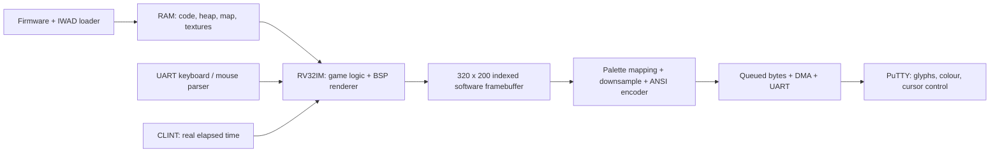
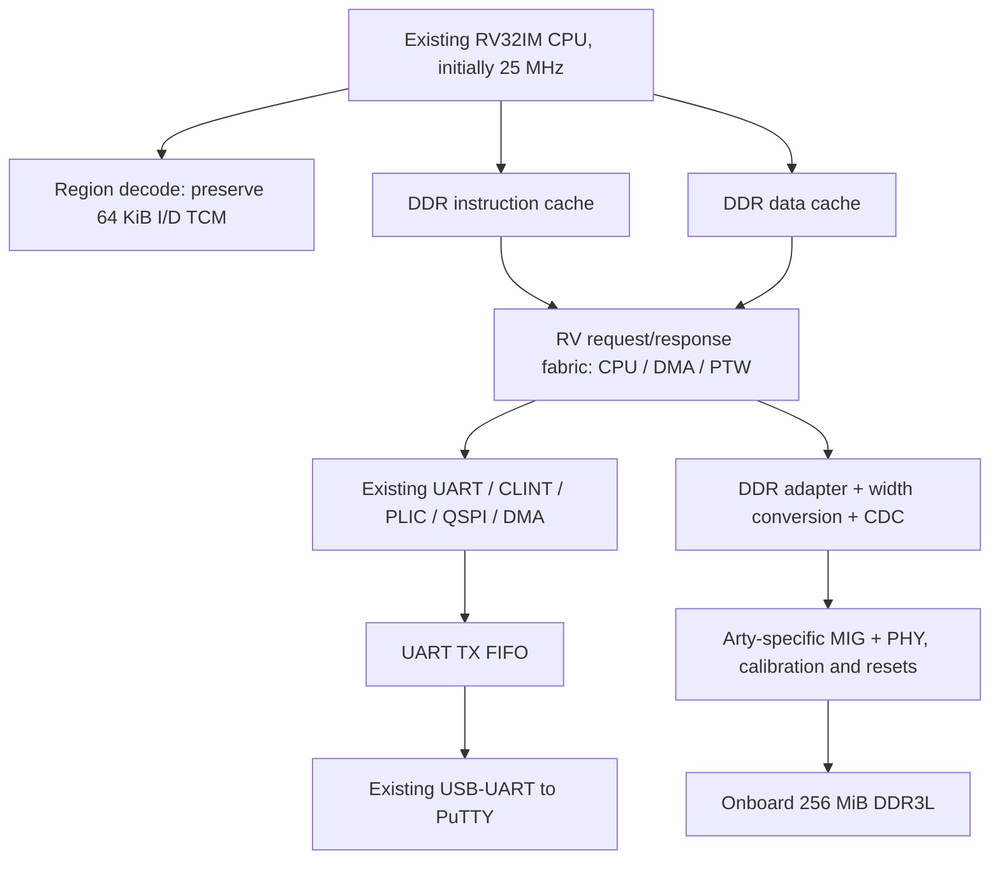

# DOOM On The Custom RV32IM CPU: Architecture And Feasibility

Study date: 2026-10-18. Target: Arty S7-50, serial terminal only.

**Conclusion: the Arty S7-50 is a credible target for real DOOM running on
this CPU, but the current 64 KiB FPGA SoC cannot run the full engine yet.**
The missing foundation is accessible external RAM. The board already has
256 MiB of DDR3L; the design needs a controller, CPU access to that memory,
and caches suitable for its latency. Terminal output is feasible, with
resolution, colour depth and frame rate limited by serial bandwidth.

This is an engineering study, not a DOOM implementation or a new bitstream.
Future resource allocations and performance goals below are explicitly
distinguished from measurements. The working Snake hardware remains the
baseline.

## 1. Sources And Reproducibility

Local source snapshots inspected:

| Project | Snapshot | Local directory |
| --- | --- | --- |
| This CPU/SoC | `112baed642e4a490c528d3538e8ea228ac373174` | Repository root |
| id Software DOOM | `a77dfb96cb91780ca334d0d4cfd86957558007e0` | `reference_doom/` |
| DE0-Nano reference | `02b17c72519561a7eb81fdcb113ce9751608182a` | `reference_retro_computing_2026/` |

The two upstream clones are ignored by the parent repository. They retain
their own Git history and notices; their binaries and WADs are not added to
this project's tracked files.

Primary external references:

- [Original DOOM source](https://github.com/id-Software/DOOM).
- [Reference console project](https://github.com/Mummanajagadeesh/retro-computing-2026).
- [Author's available DOOM article](https://mummanajagadeesh.github.io/blogs/doom-on-dual-issue-rv32im/).
- [doomgeneric platform API](https://github.com/ozkl/doomgeneric).
- [Digilent Arty S7 manual, sections 3-6](https://digilent.com/reference/_media/reference/programmable-logic/arty-s7/arty-s7_rm.pdf).
- [Digilent Arty S7-50 MIG preset](https://github.com/Digilent/vivado-boards/blob/master/new/board_files/arty-s7-50/B.0/mig.prj).
- [AMD 7-series memory-controller resource examples](https://docs.amd.com/r/en-US/ds176_7Series_MIS/Resource-Utilization).
- [PuTTY terminal settings](https://the.earth.li/~sgtatham/putty/0.85/htmldoc/Chapter4.html).
- [xterm control and mouse protocols](https://invisible-island.net/xterm/ctlseqs/ctlseqs.html).

The supplied `doom-on-de0-nano-g/` article URL was not accessible during this
study. The author's blog index links to the article above. That article
explicitly describes simulation captures. The repository also contains
FPGA integration code and bring-up notes. Those are different evidence;
simulation captures do not establish a placed-and-routed hardware FPS.

## 2. What The Reference Actually Implements

There are two separate game implementations in the reference checkout:

| Path | What the source does | Relevance |
| --- | --- | --- |
| `games/doom/build_full.sh`, `dg_platform.c`, `port/`, `w_file_blob.c` | Builds a full doomgeneric engine with platform hooks and a memory-backed IWAD | Useful basis for real DOOM |
| `games/doom/doom_native.c` | Implements a small fixed-point raycaster with a hard-coded 16x16 map and four monster slots | DOOM-style game, not the original engine |
| `games/menu/build.sh` | Links `doom_native.c` into the menu firmware | Its menu's DOOM label does not identify the full-engine port |
| `host/tinyview.py` | Receives binary 64x32 RGB332 frames and displays them using Tk/Pillow | A custom graphical PC application, not PuTTY |
| `fpga/rtl/mem_top_fpga.v` | Connects a dual-issue core to SDRAM, a small instruction cache, UART and a frame stream | Architectural reference, not a drop-in SoC |
| `fpga/rtl/sdram_ctrl.v` | Controls IS42S16160 SDR SDRAM | Cannot drive the Arty's DDR3L |

The full-engine build expects an external doomgeneric source directory and
a picolibc toolchain. The reference is not a self-contained Windows build
of upstream DOOM. A reproducible port here should pin the engine revision,
provide its own build, and implement this SoC's actual addresses and ABI.

The reference README reports 17,423 Cyclone IV logic elements and 41 M9K
blocks. No Quartus utilization report was present in the downloaded tree
to independently check those totals. Cyclone IV logic elements and
Spartan-7 LUT6s are not interchangeable counts.

### The 45 FPS Claim

The tiny binary transport carries 2,048 pixel bytes plus a 10-byte header.
At 921,600 baud, 8N1 allows 92,160 payload bytes/s:

```text
921600 / 10 / (64*32 + 10) = 44.78 complete frames/s, ideally
```

That is a link ceiling. It excludes execution, SDRAM transactions, frame
conversion and host rendering. It is not a measured full-DOOM FPS, and
does not describe an ANSI terminal stream. GIF playback speed also does
not measure the time taken to generate its frames.

## 3. What Real DOOM Needs

DOOM is a C program executing on the processor. Its code, assets and heap
live in memory; they do not each become separate FPGA logic blocks.



| Engine subsystem | Source families in `linuxdoom-1.10/` | What it needs here |
| --- | --- | --- |
| Main loop / events | `d_main`, `d_event`, `g_game` | Startup, monotonic clock, input events |
| Player / collision / monsters / doors | `p_*` | Integer CPU, maps, working heap |
| BSP traversal / walls / floors / sprites | `r_*` | Fixed-point arithmetic and efficient RAM |
| WAD directory / lump cache | `w_wad`, `z_zone` | Readable assets, bounds checks, allocator |
| Menus / HUD / intermission | `m_menu`, `hu_*`, `st_*`, `wi_*` | Same framebuffer and input |
| Video platform | `i_video`, `v_video` | A new terminal backend |
| Clock / memory / errors | `i_system` | CLINT time, libc hooks, diagnostic traps |
| Sound / music | `i_sound`, `s_sound` | Stub initially; UART is not an audio output |
| Network | `i_net`, `d_net` | Single-player stubs initially |

No Linux, Ubuntu, GPU, VGA, HDMI, USB keyboard host or external display is
required for a bare-metal terminal port. Hardware floating point, RV64,
vectors, superscalar issue and virtual memory are also not prerequisites.
Keep the five-stage CPU and start in machine mode with paging disabled.

### Integer And Floating-Point Detail

The renderer primarily uses 16.16 fixed point. RV32IM supplies the important
integer operations, including high-half multiplication and division.
64-bit intermediates can be implemented by RV32 instruction sequences and
`libgcc` helpers; RV64 is not necessary.

However, the original id Software `m_fixed.c` enables a `double` division
implementation in `FixedDiv2`. It must be replaced by an audited integer
implementation or linked with software floating-point helpers. Upstream
[doomgeneric's `m_fixed.c`](https://github.com/ozkl/doomgeneric/blob/master/doomgeneric/m_fixed.c)
uses integer arithmetic. Adding an FPU is unnecessary for this port.

## 4. Existing Hardware Versus Missing Work

The active FPGA design is `phase8/rtl/cpu_top_soc.sv` inside
`phase8/rtl/soc_core_txn.sv`. Research modules under `rtl/` do not become
part of that hardware unless instantiated and included in its build.

| Block / service | Current evidence | Needed for DOOM |
| --- | --- | --- |
| RV32IM five-stage pipeline | Existing FPGA execution, hazards, forwarding, mul/div | Reuse; profile the real workload |
| Branch prediction | Active CPU instantiation | Reuse before considering changes |
| Byte/halfword/word accesses | Active CPU/BRAM paths | Reuse; test DDR lane placement and boundary splits |
| Local instruction/data TCM | Working 64 KiB parity-banked BRAM | Preserve its speed for loader, traps and selected hot data |
| Variable-latency CPU ports | I, D and PTW requests/responses exist | Route DDR accesses correctly |
| Four-master arbiter | CPU data, PTW, CPU instructions, DMA | Extend slave routing; test simultaneous DDR/MMIO traffic |
| External DDR memory target | Not in `soc_core`'s address decoder | New mapped DDR endpoint |
| DDR3L controller / PHY | No MIG instance or DDR pins in active wrapper | Add board-specific MIG and calibration/reset management |
| AXI bridge | `rv_bus_to_axi_lite.sv` source exists | Connect and adapt protocol, width and clock to MIG |
| Instruction cache | Research `icache.sv`; absent from active manifest | Add a transaction-aware FPGA cache |
| Data cache / L2 | Research sources; absent from active manifest | Add a transaction-aware D-cache; L2 optional |
| CLINT time | `mtime`, `mtimecmp`, `msip` | Reuse; derive actual milliseconds and 35 Hz game timing |
| PLIC | Five sources; UART/DMA connected | Reuse for input/completion; GPIO/SPI slots are not actual devices |
| UART RX | 16-byte FIFO and IRQ | Increase buffering / service promptly for escape sequences and mouse reports |
| UART TX | Single-byte transmitter, no TX FIFO | Add a queue to avoid polling every transmitted byte |
| DMA | Single channel; explicit responses and UART backpressure | Reuse for encoded byte buffers; establish cache ownership |
| QSPI controller | Read-only SPI `0x03`, one byte per command | Block/stream reads desirable for multi-MiB assets |
| Resident loader | CRC-checked BRAM application, UART recovery | Add DDR initialization and larger/segmented loading |
| C startup / linker | Small BRAM layout, BSS clear, stack | DDR-aware layout, larger bounded heap and diagnostics |
| C library | Small custom UART/game routines; `-nostdlib` build | Provide libc/allocator/syscall support needed by the engine |
| WAD backend | None | Implement read-only in-memory WAD access |
| ANSI renderer | Snake has cursor/text helpers | Add framebuffer conversion, colour mapping and update scheduling |
| Terminal input parser | Character-level Snake input | Parse arrow/escape/mouse sequences and translate game events |
| Shell / window manager | Not present | Optional later; not necessary to start DOOM |

Relevant local sources:
[SoC](../phase8/rtl/soc_core_txn.sv),
[CPU](../phase8/rtl/cpu_top_soc.sv),
[manifest](../phase8/rtl/portable_soc.f),
[AXI-Lite bridge](../phase8/rtl/rv_bus_to_axi_lite.sv),
[UART](../phase8/rtl/uart.sv),
[DMA](../phase8/rtl/dma_controller.sv),
[loader](../phase8/software/bootloader.c).

### Two Important Current Limitations

`FAST_LOCAL_IMEM=1` currently selects the local instruction path globally.
It is not an address-based selector between TCM and external instructions.
Jumping to a DDR address without changing that selection can fetch an alias
from BRAM instead. Setting it to zero routes all fetches through the bus,
including BRAM, which would lose the local performance just restored.
The DOOM design needs region-aware selection and correct redirect/response
handling. Local data already has a hard-coded lower-64-KiB selection.

The research `icache.sv` services misses from its own zero-wait backing
array; `dram_ctrl.sv` wraps an internal memory model. These are useful
research components, not a working physical DDR cache hierarchy. They
need a new handshake/refill boundary before reuse in the FPGA SoC.

## 5. Measured FPGA Capacity

These are the actual current placed-design totals, not a DOOM estimate.
Source: [Vivado utilization report](../phase8/vivado/vivado_project/rv32_soc_arty_s7.runs/impl_1/soc_top_utilization_placed.rpt),
dated 2026-10-18, device `xc7s50csga324-1`.

| Resource | Current SoC | Device total | Remaining |
| --- | ---: | ---: | ---: |
| LUT6 | 7,642 | 32,600 | 24,958 |
| Flip-flops | 5,198 | 65,200 | 60,002 |
| RAMB36 tiles | 32 | 75 | 43 |
| DSP48E1 | 4 | 120 | 116 |

The latest implemented design meets 25 MHz timing with +2.828 ns setup
slack and +0.021 ns hold slack. That does not establish timing for a future
DDR/cache design, or establish 50/100 MHz operation for this CPU.

The 75 RAMB36 blocks contain 337.5 KiB of raw bits including parity.
With conventional 32-bit payload organization, capacity is about 300 KiB
before topology/port costs. The current parity-bank implementation uses
32 tiles to expose 64 KiB. Neither raw capacity nor unused tiles can be
treated as several MiB of application RAM.

### LUT Budget For The Added Hardware

There is no truthful exact DOOM LUT count before choosing and synthesizing
the new memory subsystem. DOOM C code consumes RAM/flash and CPU cycles.
MIG, caches, FIFOs, bus adapters and any accelerators consume added logic.

The following is a conservative allocation exercise, not a prediction or
a synthesis result:

| Item | LUT allocation | Evidence / interpretation |
| --- | ---: | --- |
| Existing SoC | 7,642 | Measured total; includes CPU and existing peripherals |
| DDR controller / PHY reserve | 14,016 | Borrowed from AMD's published **72-bit** DDR3 example, not the Arty's 16-bit result |
| DDR routing / width conversion / CDC | 1,500 | Engineering reserve, unmeasured |
| I/D-cache control and tags | 2,500 | Engineering reserve; data should map to BRAM |
| UART buffering / control | 600 | Engineering reserve |
| Flash streaming enhancements | 400 | Engineering reserve |
| Illustrative total | **26,658** | **81.77%** of device LUTs |
| Remaining in that exercise | **5,942** | For implementation margin / configuration differences |

AMD explicitly says utilization changes with interface settings. Its
14,016-LUT example is a different width and device configuration; it is
neither an upper bound nor the cost of our board's MIG. The smaller Arty
interface may use less, but only its generated IP and full synthesis can
establish that. No sound/video accelerator is budgeted here.

A first BRAM planning envelope is 32 existing tiles + 8-12 for cache data,
tags and FIFOs + 2-6 reserved for MIG/CDC: 42-50 total. These are allocation
targets, with port widths and inference still to be checked. DSP usage can
stay at four for the baseline software-rendered implementation.

**Feasibility assessment:** the current headroom and onboard DDR make the
board a reasonable target. Fit and timing are still implementation gates;
the study does not certify a completed DOOM design.

## 6. Memory Requirements From Actual Files

Inspected the supplied full-engine `games/doom/doom.elf` with
`riscv-none-elf-size`, `readelf` and `nm`:

| Item | Bytes | Interpretation |
| --- | ---: | --- |
| ELF file on disk | 723,132 | Includes ELF headers/symbol information; not RAM demand |
| `text` | 379,200 | Code plus read-only data |
| `data` | 59,828 | Initialized globals |
| `bss` | 241,532 | Zero-initialized globals |
| Initialized sections subtotal | 439,028 | About 429 KiB before alignment / load segment details |
| Static section subtotal | 680,560 | About 665 KiB, before heap and WAD |
| Reserved heap in reference linker | 12,582,912 | 12 MiB, includes the engine's zone allocation |
| Reserved stack in reference linker | 524,288 | 512 KiB; reservation, not a measured minimum |
| Reserved WAD region in reference | 31,457,280 | 30 MiB; not the actual asset size |

The ELF is RV32 little-endian, entry `0x00000000`, with architecture
attributes `rv32i2p1_m2p0_zicsr2p0_zmmul1p0`, a 16-byte stack alignment,
and real `D_DoomMain`, `D_DoomLoop`, `doomgeneric_Create` symbols. It is a
real full-engine binary, but its addresses/MMIO are for the reference SoC.
It cannot be loaded unchanged by our loader.

WAD headers and every lump's bounds were inspected using `BinaryReader`:

| Asset in the reference | Actual bytes | MiB | Directory / selected contents |
| --- | ---: | ---: | --- |
| `doom1.wad` | 4,196,020 | 4.001637 | IWAD; 1,264 lumps; `E1M1`, `PLAYPAL`, `PNAMES`; directory in bounds |
| `freedoom1.wad` | 28,795,076 | 27.461124 | IWAD; 3,163 lumps; `E1M1`, `PLAYPAL`, `PNAMES`; directory in bounds |

Both files have a 10,752-byte PLAYPAL lump: multiple 256-colour RGB
palettes. Preserve palette changes for damage flashes and other effects;
indices are not directly RGB332 colours.

The classic engine uses a 320x200, one-byte-per-pixel screen: **64,000
bytes for one frame**. That alone exceeds our loader's 48 KiB application
region. The engine also has additional screen/transition allocations and
tables. Shrinking terminal output to 80 columns does not remove the
engine's code, asset or heap requirements.

Use roughly 16 MiB of working RAM plus a separately stored ~4 MiB
shareware IWAD as a comfortable initial planning envelope, then measure
actual heap/stack high-water marks. This is not a minimum requirement.
Upstream doomgeneric currently defaults to a 16 MiB zone unless configured;
set an explicit zone size such as `-mb 6` for that initial envelope, or
allocate a larger heap. The zone is inside the libc heap, not additional
RAM to count twice. A 64 MiB DDR allocation comfortably accommodates the
larger reference asset and sensible reserves; the board has 256 MiB.

## 7. Proposed Hardware Architecture



### DDR Controller And Board Integration

Use the AMD MIG for the physical DDR3L controller/PHY, retaining custom
RTL for the CPU and bus integration. Digilent provides a board preset and
pin mapping. DDR is already soldered to the Arty; another RAM board is
not necessary.

Required integration details:

1. Add the onboard 100 MHz input on R2 for the MIG system-clock path.
2. Apply the memory's actual 1.35 V interface, address/data/strobe pins,
   internal VREF and generated timing constraints for the board revision.
3. Generate MIG with the correct x16 component and reference-clock setup.
4. Wait for `init_calib_complete` and handle calibration timeout/recovery.
5. Cross requests/responses safely between the 25 MHz CPU and MIG UI clock.
6. Map read/write errors and reset outstanding transactions consistently.
7. Validate DDR addresses at the ends of the full mapped range; do not
   silently truncate addresses into aliases.

The Digilent preset selects a ~3.077 ns memory clock, approximately
325 MHz / 650 MT/s, and a 4:1 PHY ratio. A corresponding UI is roughly
81.25 MHz. These are memory-system clocks, not a new CPU clock. The exact
UI clock and data width come from the generated IP configuration.

### AXI And Native MIG Are Different Interfaces

Our bridge produces 32-bit AXI4-Lite transactions. The published board
preset selects full AXI with a 128-bit data bus, 28-bit address and IDs.
Those ports do not connect directly.

Two valid approaches are:

- Convert the RV bus to the MIG native command/write-data/read-data ports.
- Use AXI interconnect/conversion and clock crossing between our bridge and
  the generated full-AXI MIG. Cache bursts can later use a dedicated AXI path.

A native adapter must independently honor command readiness and write-data
readiness, retain the data until accepted, align DDR transfers, preserve
byte masks and return the right word lanes. A typical x16 BL8 transfer is
16 bytes; a 128-bit UI exposes that as one data beat. Map CPU byte addresses
to the generated MIG's address units explicitly. An AXI converter similarly
needs lane placement and correct narrow-write behavior; the published
preset disables narrow bursts.

Cross clock domains with a proven asynchronous FIFO or complete request /
acknowledgement mechanism. Synchronizing address bits separately does not
transfer a coherent transaction.

### Caches And DMA Ownership

Start with approximately 8 KiB I-cache and 8 KiB D-cache, 32-byte lines,
simple associativity, and BRAM storage. These are starting choices, not
requirements proven by a benchmark. Keep the TCM path separate. A small
blocking cache can be correct; pipelining/prefetch are later optimizations.

Refills must wait for actual responses, handle errors, and hold stable
requests under backpressure. The existing RV bus can refill a line through
multiple word requests. A burst-capable backing adapter is preferable for
DDR efficiency, but must be implemented rather than assumed from AXI-Lite.

Cache only explicitly cacheable DDR regions. MMIO must never be cached,
speculatively read or written twice. Handle byte writes and accesses
crossing words, cache lines and memory-region boundaries.

For an initial write-through D-cache, drain pending stores before DMA
reads. DMA writes require invalidating stale CPU cache lines before the
CPU reads that buffer. Alternatively place DMA buffers in an uncached
region or local TCM. A future write-back cache additionally needs clean
operations. `FENCE.I` must invalidate the real I-cache after code loading;
the current pipeline redirect alone is not that maintenance operation.

The shared bus currently has a single active target transaction. A DMA
write waiting for a busy UART can block unrelated fabric traffic until
accepted. A TX FIFO reduces that pressure; routing/arbitration should be
tested with input, DDR misses and display traffic together. DMA saves
instruction work but does not increase the UART's byte rate.

## 8. Proposed Address And Boot Layout

Keep the established BRAM/MMIO map and add a separate physical DDR window:

| Region | Address range | Meaning |
| --- | --- | --- |
| Local BRAM | `0x00000000..0x0000FFFF` | Existing loader, traps and local scratch |
| CLINT | Existing `0x02000000` region | Time and software interrupt |
| PLIC | Existing `0x0C000000` region | External interrupt control |
| UART / QSPI / DMA | Existing `0x10000000`, `0x10001000`, `0x10002000` | Preserve software-visible devices |
| New DDR | `0x80000000..0x8FFFFFFF` | 256 MiB physical window, proposed |

Example DDR reservations, all proposed:

| Purpose | Reservation | Size |
| --- | --- | ---: |
| Engine code / rodata / globals | `0x80000000..0x801FFFFF` | 2 MiB |
| Heap including DOOM zone | `0x80200000..0x80FFFFFF` | 14 MiB |
| Stack | `0x81000000..0x8107FFFF` | 512 KiB |
| Framebuffers / terminal scratch | `0x81100000..0x811FFFFF` | 1 MiB |
| IWAD reservation | `0x82000000..0x83FFFFFF` | 32 MiB |

Linker assertions must enforce actual bounds and stack/heap separation.
Use segment lengths, not reserved heap/WAD regions, when creating firmware
files; otherwise sparse runtime reservations inflate uploads needlessly.
Measure allocator/stack use and adjust this plan after a real build.

### Loader Changes Are Necessary

The current loader, linker, uploader and flash packer all target the
BRAM application at `0x00004000`, maximum 49,152 bytes. Its flash header
requires that entry address. Increasing just a linker constant is not
enough.

Add a versioned, bounded load manifest with destination, initialized length,
entry address, WAD length/location and CRCs. The resident loader must remain
in local RAM while it initializes DDR and copies the application/assets.
Wait for writes to complete and invalidate instruction cache before jumping
to the DDR entry. Implement real trap diagnostics rather than silently
halting on an unexpected exception.

The current so-called Boot ROM is firmware initialized into writable BRAM;
it is not a separate immutable ROM primitive. Protecting its address region
and retaining a known recovery path is useful as the loader grows.

### Flash Capacity And Loading Time

The board flash is 16 MiB. The current application begins at `0x00400000`,
leaving 12 MiB above that offset. A compact engine image and the inspected
~4 MiB shareware WAD can fit there with a manifest. The inspected 27.46 MiB
Freedoom WAD cannot fit in the entire flash uncompressed.

A possible future allocation is 0-4 MiB for FPGA configuration/reserve,
4-6 MiB for the application, and the WAD starting at 6 MiB. This is a
proposal; the existing image format and flash tooling do not do it yet.

The current `qspi_reader.sv` uses single-bit SPI command `0x03`, even though
the flash and FPGA configuration support quad mode. It sends a new command
and 24-bit address for every byte: at a 25 MHz controller clock its ideal
wire-only payload ceiling is 312,500 bytes/s. A 4,196,020-byte WAD takes
at least 13.43 s before software/MMIO/CRC overhead. Streaming contiguous
reads avoids repeating the 32 command/address bits for every byte.

At 115,200 baud that WAD alone takes at least 364.24 s to upload; at
1,000,000 baud at least 41.96 s. Those exclude acknowledgements, pacing
and processing. The current 2 ms/byte host pacing would add roughly
2.33 hours for that asset, so a large-image uploader needs proper chunk
flow control rather than reusing the current setting unchanged.

## 9. Terminal Rendering And Its Hard Limits

The processor will run the engine and convert its output. PuTTY will only
display the received characters/colours and send input. No PC-side DOOM
logic or binary-frame graphics viewer is necessary for this design.

ANSI cursor control is a text interface. It does not interpret a sequence
of 64,000 palette bytes as a bitmap. The terminal backend must map pixels
to printable cells. Keep a native indexed frame initially, downsample it,
then emit an ASCII luminance ramp or coloured block glyphs. Rendering the
engine itself at a lower resolution is a separate optimization and must
also handle menus/HUD and hard-coded engine dimensions.

For 8N1:

```text
serial payload bytes/s <= baud / 10
link-only FPS <= (baud / 10) / encoded bytes per frame
```

Calculated examples:

| Stream | Bytes/frame | Ideal FPS @115200 | @921600 | @1000000 |
| --- | ---: | ---: | ---: | ---: |
| Native 320x200 indexed binary, not ANSI | 64,000 | 0.180 | 1.440 | 1.563 |
| Reference 64x32 binary + header, not ANSI | 2,058 | 5.598 | 44.781 | 48.591 |
| 80x25 ASCII luminance | 2,051 | 5.617 | 44.934 | 48.757 |
| 80x40 ASCII luminance | 3,281 | 3.511 | 28.089 | 30.479 |
| 80x20 UTF-8 cells, indexed foreground/background every cell | 40,041 | 0.288 | 2.302 | 2.497 |
| 80x20 UTF-8 cells, true-colour foreground/background every cell | 65,641 | 0.176 | 1.404 | 1.523 |

ASCII figures assume `ESC[H` plus two bytes between rows, with terminal
wrap disabled. Block examples represent an 80x40 sample image encoded as
two vertical samples per cell: 1,600 cells, three-byte glyphs, plus two
maximum-length SGR colour sequences for every cell and row separators.
They illustrate an inefficient but valid encoder, not a lower bound.
Colour reuse, combined escapes and changed-span updates can reduce bytes
substantially. Full-screen movement can defeat dirty-cell savings.

All table entries exclude engine execution, encoding, UART idle gaps,
USB/driver effects and terminal drawing. 80x40 ASCII at 1 Mbaud is at most
30.48 frames/s on the wire, not a promise of 30 FPS gameplay.

### Recommended Initial Display Modes

1. Prove one static ASCII frame and responsive terminal input.
2. Run real E1M1 gameplay in 80x25 ASCII, initially without sound.
3. Add larger ASCII output after profiling engine and serial cost.
4. Add 16-colour/256-colour block modes with run-length colour changes,
   changed spans and an explicit byte budget per displayed frame.

Use a palette lookup table instead of doing 256 colour searches for every
pixel. Rebuild it when the active DOOM palette changes. Account for the
font's cell aspect ratio, leave room for the HUD, hide the cursor, avoid
clearing the entire screen for each frame, and restore terminal modes on
exit. A one-time clear plus cursor-positioned updates avoids scrolling.

Double-buffer encoded output or transfer immutable spans so DMA never
reads a buffer the encoder is rewriting. Bound queued output; drop or
coalesce stale display frames to keep controls responsive. A desktop with
dragging windows benefits from changed rectangles; DOOM camera movement
changes much more of the screen, so it needs a worst-case full-frame budget.

### Baud Rate With The Existing 25 MHz UART

Both TX and RX currently use integer division `CLK_FREQ / BAUD_RATE`:

| Requested baud | Divisor | Actual bit rate | Error |
| --- | ---: | ---: | ---: |
| 115,200 | 217 | 115,207.373 | +0.006% |
| 460,800 | 54 | 462,962.963 | +0.469% |
| 921,600 | 27 | 925,925.926 | +0.469% |
| 1,000,000 | 25 | 1,000,000 | 0% |
| 2,000,000 | 12 | 2,083,333.333 | +4.167% |

1 Mbaud is an attractive first high-speed target. 921,600 is also a
candidate, subject to board/host testing. 2 Mbaud requires improved divider
generation or a suitable UART clock before relying on it. The board's
FT2232HQ supports high-speed UART, but its datasheet rate is not proof of
end-to-end throughput through this RTL and the host driver.

The current 16-byte RX FIFO holds only about 160 microseconds of continuous
input at 1 Mbaud. Input service must run during display transfers; use a
larger FIFO and/or a prompt ISR with a software event queue. Back-to-back
and long-duration bidirectional tests are necessary at the chosen rate.

## 10. Keyboard, Mouse And The Desktop Idea

Configure PuTTY for serial 8N1, matching baud, local echo off and local line
editing off. Use UTF-8 and a font with single-cell block glyphs for block
mode; enable the relevant ANSI/256-colour settings. Leave xterm mouse
reporting permitted when using mouse input. `TERM` is not automatically
sent over a bare serial wire; firmware must have a chosen profile or a
bounded capability handshake.

An incremental input parser needs to accept fragmented sequences across
UART reads, ordinary characters, `ESC [ A/B/C/D`, application cursor-key
forms, Enter, Backspace and Escape. Give standalone Escape a timeout so it
can be distinguished from the beginning of a cursor/mouse sequence.

**Normal terminal keyboard input does not provide reliable key-up events
or a complete simultaneous-key state.** This matters for walking while
turning/firing. The reference graphical viewer sends explicit releases
with a private `0xF0` prefix; PuTTY does not implement that private scheme.

For a PuTTY-only baseline, translate taps/repeats into short game-key holds
with timed releases, and support toggles for continuous actions if useful.
This changes the control feel and must be tested. An enhanced terminal
keyboard protocol would require separately verified terminal support; it
must not be assumed for ordinary PuTTY.

For a text desktop, xterm button/drag reporting plus SGR mouse encoding can
provide button presses/releases and character-cell coordinates. Typical
modes are `1002` for drag events and `1006` for SGR encoding, producing
`ESC[<button;column;rowM` or a lower-case final `m` for release. Negotiate or
fall back if unsupported. `1006` alone does not enable event tracking.

Mouse positions are bounded to the terminal window; this is not an
unlimited relative-motion FPS mouse. Use coordinate deltas with that
limitation. Avoid enabling all-motion reporting unnecessarily because it
can fill input buffers. Restore mouse/cursor/alternate-screen modes on exit.

A draggable text desktop and command shell are additional software: cell
compositor, z-order, focus, clipping, input dispatch and application launch.
They can host a DOOM terminal window later, but are not supplied by ANSI
itself and are not required for the first playable engine.

## 11. Runtime And Timing

Use a pinned doomgeneric version and implement `DG_Init`, `DG_DrawFrame`,
`DG_SleepMs`, `DG_GetTicksMs`, `DG_GetKey`, and optional window-title hook.
Add a bounded memory-backed WAD backend and the file-existence checks it
needs. Read-only assets do not require an SD card or FAT filesystem.
Savegames/configuration writes can initially return a controlled failure
or live in a small RAM store.

The build needs consistent RV32 integer libraries, allocation, memory/string
routines, formatted I/O and necessary compiler helpers. Select the correct
libc's syscall hooks; the reference's picolibc `FILE` definitions are not
portable verbatim to newlib. Inspect any TLS use and initialization too:
the reference ELF contains a small TLS segment. Link the proper library
variant rather than assuming `-nostdlib` provides runtime services.

Build with the implemented ISA/ABI, such as
`-march=rv32im_zicsr_zifencei -mabi=ilp32`, and verify multilib selection and
the final disassembly. Do not allow compressed, floating-point or atomic
instructions through unrelated compiler/library defaults. Initialize `gp`,
16-byte-aligned `sp`, BSS, traps and any required runtime sections.

Use CLINT `mtime`, which currently increments at the system clock even when
pipeline transactions stall. Read a 64-bit value high/low/high on RV32 and
retry if the upper word changed. Derive milliseconds from the actual timer
frequency. Do not copy the reference's `/1000` cycle conversion: at 25 MHz,
one millisecond is 25,000 timer ticks. Account for wraparound in the API.

Normal game simulation runs at 35 tics/s. Rendering and UART delivery may
run at a lower rate. Use elapsed time and a bounded catch-up strategy;
never advance the world simply once per UART frame. Keep timedemo/
`-singletics` benchmarking separate from normal real-time pacing.

| CPU clock | Total cycles available per 35 Hz game tic |
| --- | ---: |
| 25 MHz, current | 714,286 |
| 50 MHz, hypothetical future build | 1,428,571 |
| 100 MHz, hypothetical future build | 2,857,143 |

The reference simulation reports roughly 1.62 million cycles/tic in one
configuration. That is a different dual-issue CPU and memory model, so it
cannot predict our throughput. At 25 MHz this port needs measurement and
likely rendering/memory optimization to meet the full 35 Hz workload.
No exact playable FPS or CPU frequency increase is established here.

Measure engine time, encoding time, transmitted bytes, displayed FPS,
game tics/s, cache misses, memory wait cycles and input latency separately.
Where the current retirement counter's definition differs from WB retire,
do not interpret its ratio as an architectural IPC without checking it.
UART LED blink rate measures traffic timing, not CPU throughput.

## 12. Implementation Order And Acceptance Gates

| Stage | Change | Completion evidence |
| --- | --- | --- |
| 0. Baseline | Preserve verified source/bitstream and Snake boot | Existing recovery and performance remain reproducible |
| 1. Terminal transport | High-speed UART, TX/RX queues, input parser and synthetic ANSI frames | Sustained bidirectional byte test, no drops; measured full-screen bytes and latency |
| 2. Physical DDR | Board MIG wrapper, calibration, safe clock crossing and diagnostics | Board report: DDR calibrated and `DDR:ADDRESS`, `DDR:LANES`, `DDR:PATTERN`, `DDR:PASS` printed in PuTTY on October 19, 2026 |
| 3. CPU DDR access | DDR target, region-aware fetch and data routing | Board report: `DDR:DMA PASS` and `DDR:EXEC PASS`; separate Vivado DDR build closed timing with +0.345 ns setup WNS |
| 4. Cache path | Real I/D caches, maintenance and DMA ownership | Directed/random miss/backpressure/error tests; code reload and DMA visibility pass |
| 5. Large firmware | DDR linker/runtime, versioned loader, IWAD transfer | Executable and WAD CRC/readback pass; corrupt/truncated/out-of-range images recover safely |
| 6. Engine boot | Pinned full engine and platform hooks, initially no sound | WAD parses, first real E1M1 framebuffer is nonblank and matches an engine reference |
| 7. Terminal gameplay | ANSI display, bounded output, terminal controls | Walking, turning, firing, doors, menus and quit work; measured displayed FPS and game rate reported |
| 8. Optimization | Cache policy, render settings, baud/clock improvements as measurements justify | Repeatable timedemo with input and serial service active; timing re-closed for any clock change |
| 9. Permanent boot | Flash manifest, streaming asset reads, DDR load and UART recovery | Cold boot to game without re-synthesis; damaged flash still enters recovery |

Synthetic terminal tests and a host build of the full engine can proceed
while preparing DDR. A host build validates the terminal encoder and
control translation, not execution on our CPU. FPGA synthesis,
implementation and bitstream generation are separate user-run gates.

Do not replace the working Snake startup image until the new DDR loader
and its recovery are demonstrated. Add DOOM as a separate build/boot target
and use deterministic frame checks and cycle measurements to catch errors.

## 13. Scope And Outstanding Measurements

DOOM engine code is GPL-licensed; preserve upstream notices and source
provenance. WAD assets have separate terms and do not inherit the engine
license. Keep the downloaded research assets separate from our source
distribution and choose the intended shareware, owned IWAD or Freedoom
content explicitly.

Still unknown until implementation: selected MIG utilization, total
cache/CDC resources, DDR latency seen by this CPU, CPU/cache timing closure,
real game cycles/tic, allocator/stack use, encoded bytes for moving scenes,
host serial reliability and terminal input latency. The report provides
measured baseline resources and calculated serial ceilings, not invented
measurements for those unknowns.

Reproduce the serial calculations from the repository root:

```powershell
powershell -NoProfile -ExecutionPolicy Bypass -File riscv_processor_cpu/docs/doom_budget.ps1
```

The Arty DDR3L foundation has a separate bring-up project, a 128-bit MIG AXI
bridge, and a TCM-resident diagnostic. The user has now observed `DDR:PASS`
on the physical board, including DMA and execution from DDR. A separate
BRAM-resident `RDD1` UART loader and DDR-linked test application pass
end-to-end CPU/UART/DDR simulation (`make ddr_loader_sim`). On October 19,
2026 the user also reported `DDR_APP:PASS code/data/BSS from DDR` on the
physical board after `make ddr_upload PORT=COM4 UPLOAD_DELAY=2 RUN=1`.
This does not yet imply that DOOM, its IWAD,
large-file transfer, caches, or terminal rendering work on this CPU.

From `phase8/software`, `make ddr_loader ddr_app_test` builds the isolated
images without replacing Snake or the DDR diagnostic. The generated Vivado
project is at `phase8/vivado/ddr_project/arty_s7_ddr_loader/rv32_soc_arty_s7.xpr`;
the user runs synthesis, implementation, and bitstream generation there.
If recreating it in a fresh directory, use `make ddr_loader_project` after
removing or renaming the old loader project yourself.
After programming that bitstream and closing PuTTY, run
`make ddr_upload PORT=COM4 UPLOAD_DELAY=2 RUN=1` to send the 1,168-byte
test application. Successful board output is `RDD1:OK`, `RDD1:GO`, then
`DDR_APP:PASS code/data/BSS from DDR`. Without `RUN=1`, reopen PuTTY and
press `G`. The first version sends 16-byte acknowledged blocks with 2 ms
host pacing and is not a practical multi-megabyte IWAD transport yet.

For the PuTTY handoff, the uploader now queries `I` after verification and
requires `LOADED` to match the image length before releasing COM4. Open
PuTTY at 115200 baud, press uppercase `I` to inspect that state, then `G`
to run. Do not reset, reprogram, or power-cycle between upload and `G`:
startup clears the loader's verified-image state, and `G` then reports
`RDD1:ERR NO_IMAGE`. Starting another upload also invalidates that state.
An already visible startup banner in PuTTY does not establish when a reset
occurred. If the uploader confirms `LOADED=1168` but PuTTY subsequently
reports `LOADED=0`, the state changed during the handoff; investigate that
transition before rebuilding hardware. `RUN=1` starts and captures the test
output in the uploader, avoiding the terminal handoff.
